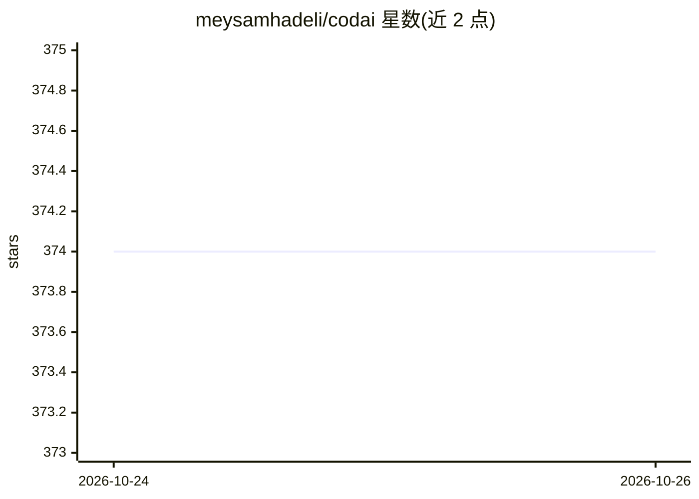

# meysamhadeli/codai

⭐ 374 · C# · Apache-2.0 · 推送 2026-10-23 · [GitHub](https://github.com/meysamhadeli/codai) · 个人维护

**开源终端 AI 编程 Agent：在终端里探索代码、计划并跨文件修改**

基于 .NET 构建的命令行编程 Agent：以 Plan 模式只读探索代码库，经用户批准后切换到 Agent 模式执行文件修改与 Shell 命令；支持按需发现上下文而非全项目索引，可连接 OpenAI、Anthropic、Gemini、Ollama 等托管或本地模型，并提供 MCP 服务器、.NET 插件与生命周期钩子扩展。会话可压缩上下文并断点续接，需 .NET SDK 10.0+，通过 dotnet tool 安装。

## 筛选速览

| 维度 | 判定 | 备注 |
|---|---|---|
| AI 角色 | `ai-ecosystem` | LLM/agent 周边工具 |
| 许可风险 | `permissive` | Apache-2.0 |
| 部署形态 | `None` |  |
| 模型依赖 | local-ok | 支持本地模型 |
| 硬件要求 | — | 无带数字的原话,不猜 |
| 安装摩擦 | `medium` | 含编译或系统依赖之一 |
| 成熟度 | — | 结构信号不足 |

## 能力要点

- Plan 只读模式 + Agent 模式的分阶段执行与批准策略
- 支持 10 家提供商（含本地 Ollama，无需 API key）
- MCP 服务器、.NET 插件与生命周期钩子扩展工具
- 会话上下文压缩与 codai code --continue 恢复

## 适用场景

- 在终端里让 AI 探索代码库并按计划实施跨文件修改
- 连接本地 Ollama 模型进行离线编程辅助
- 通过项目规则、技能与记忆文档复用工作流

## 场景标签

`编码 Agent` · 领域:编码与开发

## 证据(README 行号)

> L3: The open source coding agent for your terminal.
> L17: Explore a codebase, plan a change, and work across files with explicit approval for writes
> L18: and commands. Start read-only in Plan mode, then switch to Agent when you are ready to build.

## 星数曲线

2026-10-24 374 → 2026-10-26 374（+0）

---
*卡片 v1 · prompt 1.4 · 生成 2026-10-23 · 置信度 high · 依据 README sha `62d717846758` · [字段定义](../../DATASET.md)*
