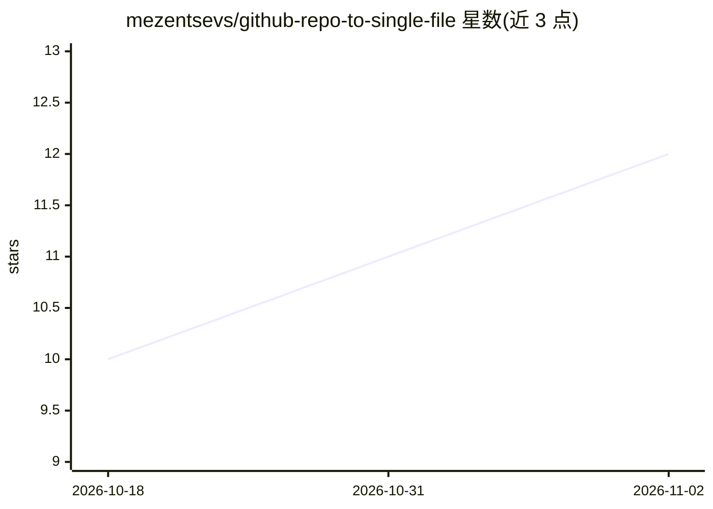

# mezentsevs/github-repo-to-single-file

⭐ 12 · TypeScript · MIT · 推送 2026-07-10 · [GitHub](https://github.com/mezentsevs/github-repo-to-single-file) · 个人维护

**把任意 GitHub 仓库下载为单个结构化文本文件的 CLI 工具**

基于 Node.js/TypeScript 与 GitHub REST API 的命令行工具：通过文件树 API 获取指定仓库和分支的文件列表，按 INCLUDE/EXCLUDE 模式（简单通配、glob、精确路径三类）过滤后逐个下载内容，输出为带 '=== filename ===' 分隔标记和头部元信息的单一文本文件。支持可选 GitHub Token 以访问私有仓库并提升速率限制至每小时 5000 次请求，提供 API 请求间隔配置与自动等待限流处理。安装方式为 git clone 后 npm install，经 npm start/download 运行。

## 筛选速览

| 维度 | 判定 | 备注 |
|---|---|---|
| AI 角色 | `ai-enhanced` | 去掉 AI 部分产品仍成立 |
| 许可风险 | `permissive` | MIT |
| 部署形态 | `library` | 以包/库形式分发 |
| 模型依赖 | — | README 未给出锁定关系 |
| 硬件要求 | — | 无带数字的原话,不猜 |
| 安装摩擦 | `low` | 无编译、无系统依赖或容器化 |
| 成熟度 | — | 结构信号不足 |

## 能力要点

- 三类过滤模式（简单通配/glob/精确路径）与包含排除优先级规则
- 输出单一结构化文本文件（=== filename === 分隔 + 仓库/分支/时间头部）
- 可选 GitHub Token 支持私有仓库下载并将速率限制从 60 提升至 5000 次/小时
- 自动等待 API 限流、失败文件生成占位信息

## 适用场景

- 我把整个仓库源码导出成一个文本文件以便查阅或投喂给 LLM
- 只导出某仓库的源码文件而排除测试、媒体与二进制文件
- 批量导出文档类文件（md/txt）用于阅读

## 场景标签

 · 领域:开发者工具/代码导出

## 证据(README 行号)

> L7: A lightweight and convenient application that downloads any GitHub repository as a single, well-structured text file

## 星数曲线

2026-10-18 10 → 2026-11-02 12（+2）

---
*卡片 v1 · prompt 1.4 · 生成 2026-11-02 · 置信度 low · 依据 README sha `273db48ff0da` · [字段定义](../../DATASET.md)*
