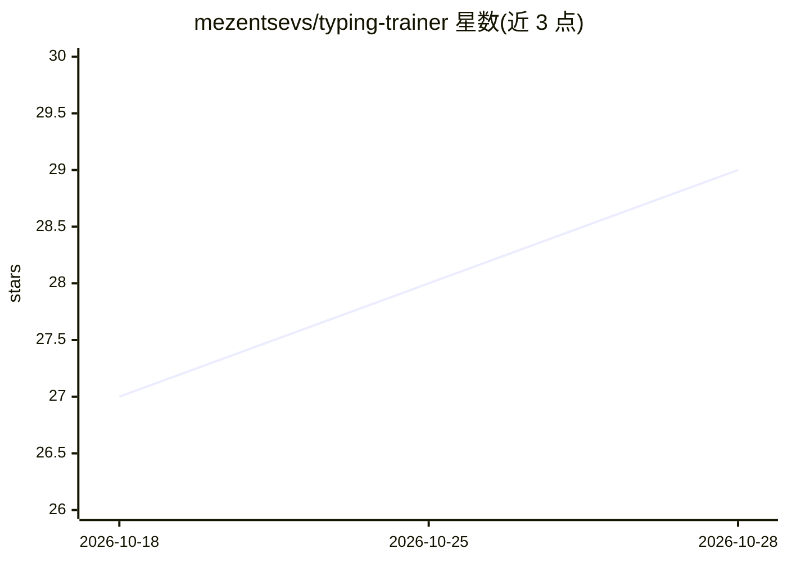

# mezentsevs/typing-trainer

⭐ 29 · PHP · MIT · 推送 2026-10-27 · [GitHub](https://github.com/mezentsevs/typing-trainer) · 个人维护

**自托管的盲打练习 Web 应用，AI 生成测试文本**

基于 PHP/Laravel + Vue/TypeScript 的全栈单页盲打训练器：按语言和数量生成随机练习课程，最终测试的文本可通过多种策略获取——云端或本地 AI 模型按体裁生成、内置种子数据库或用户上传文件。功能包括虚拟键盘多布局高亮、逐字符错误提示、实时 WPM/错误数/用时统计与进度跟踪，带用户注册登录与令牌鉴权。通过 Docker Sail 运行，需自行配置 .env 中的 AI 模型（README 测试组合为 LM Studio + qwen3-1.7b）。项目声明处于活跃开发中。

## 筛选速览

| 维度 | 判定 | 备注 |
|---|---|---|
| AI 角色 | `ai-enhanced` | 去掉 AI 部分产品仍成立 |
| 许可风险 | `permissive` | MIT |
| 部署形态 | `library` | 以包/库形式分发 |
| 模型依赖 | — | README 未给出锁定关系 |
| 硬件要求 | — | 无带数字的原话,不猜 |
| 安装摩擦 | `low` | 无编译、无系统依赖或容器化 |
| 成熟度 | `idea` | |

## 能力要点

- 按语言/数量生成随机练习课程，难度随进度调整
- 最终测试文本支持云端/本地 AI、种子数据库、自定义文件三种来源
- 虚拟键盘多布局支持与下一按键高亮
- 逐字符实时校验、错误高亮与 WPM/错误/用时统计

## 适用场景

- 自托管一个网页端盲打训练工具供个人或教学使用
- 用本地 LLM 生成指定体裁的打字练习文本
- 多语言键盘布局的打字肌肉记忆训练与进度统计

## 场景标签

 · 领域:教育/打字训练工具

## 证据(README 行号)

> L11: A full-stack SPA typing trainer for mastering touch-typing. It generates random lessons based on language and count
> L41: ### AI-Powered Content & Extensible Text Generation Strategies
> L123: - Configure your AI model in .env (tested with LM Studio + qwen/qwen3-1.7b)

## 星数曲线

2026-10-18 27 → 2026-10-28 29（+2）

---
*卡片 v1 · prompt 1.4 · 生成 2026-10-26 · 置信度 high · 依据 README sha `ba56a4eabafb` · [字段定义](../../DATASET.md)*
