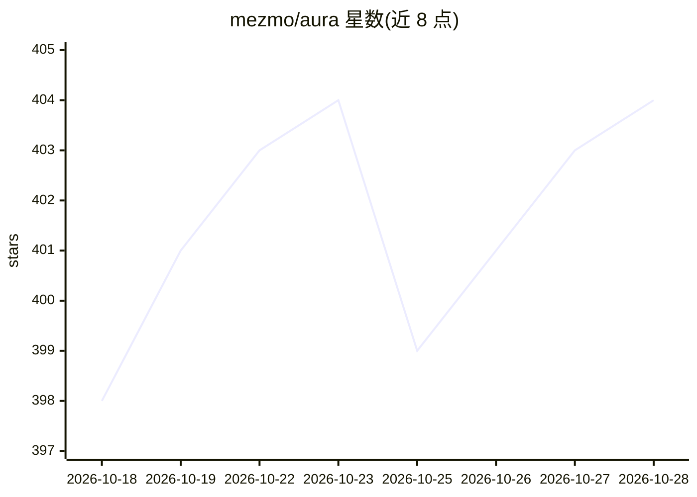

# mezmo/aura

⭐ 404 · Rust · Apache-2.0 · 推送 2026-10-27 · [GitHub](https://github.com/mezmo/aura) · [官网](https://www.mezmo.com/aura) · 组织维护

**面向 SRE 的生产级 agent 平台：在自有基础设施内运维排障**

Mezmo 开源的 SRE agent 平台，提供预配置专家 agent 团队用于事故调查。核心机制包括：以可版本化评审的 TOML 定义模型、agent 团队、审批策略与护栏；通过 MCP（Streamable HTTP/SSE/STDIO）连接工具并以 Qdrant 或 Bedrock Knowledge Bases 做 RAG；敏感工具调用需人工审批且失败即拒绝（fail-closed）；输出 OpenTelemetry 追踪。支持 OpenAI/Anthropic/Bedrock/Gemini/Ollama/OpenRouter 多提供商切换，可本地 CLI、Web 服务、Docker、Helm 或嵌入 Rust 核心运行，Apache-2.0 许可。

## 筛选速览

| 维度 | 判定 | 备注 |
|---|---|---|
| AI 角色 | `ai-ecosystem` | LLM/agent 周边工具 |
| 许可风险 | `permissive` | Apache-2.0 |
| 部署形态 | `library` | 以包/库形式分发 |
| 模型依赖 | local-ok | 支持本地模型 |
| 硬件要求 | — | 无带数字的原话,不猜 |
| 安装摩擦 | `low` | 无编译、无系统依赖或容器化 |
| 成熟度 | — | 结构信号不足 |

## 能力要点

- TOML 统一定义 agent 团队、审批策略与护栏，可版本化评审
- MCP 工具发现 + Qdrant/Bedrock Knowledge Bases 的 RAG 接地
- 敏感工具调用人工审批，失败按 fail-closed 处理
- OpenAI 兼容 API，LibreChat/OpenWebUI 等客户端可直接使用

## 适用场景

- 让 agent 团队调查生产事故并给出回滚建议
- 在自有或隔离网络环境内运行 AI 运维 agent
- 通过现有聊天客户端接入 SRE agent

## 场景标签

`Agent 框架` `多智能体` · 领域:Agent 开发

## 证据(README 行号)

> L2:  AURA is a production-tested SRE agent platform you can deploy in minutes.
> L19: AURA handles the guardrails, APIs, state management, streaming, failure handling, and observability needed to conne
> L57: - **Connect tools and RAG.** Discover tools from compatible MCP servers over Streamable HTTP, SSE, or STDIO, and gr

## 星数曲线

2026-10-18 398 → 2026-10-28 404（+6）

---
*卡片 v1 · prompt 1.4 · 生成 2026-10-21 · 置信度 high · 依据 README sha `cd545fb87fae` · [字段定义](../../DATASET.md)*
