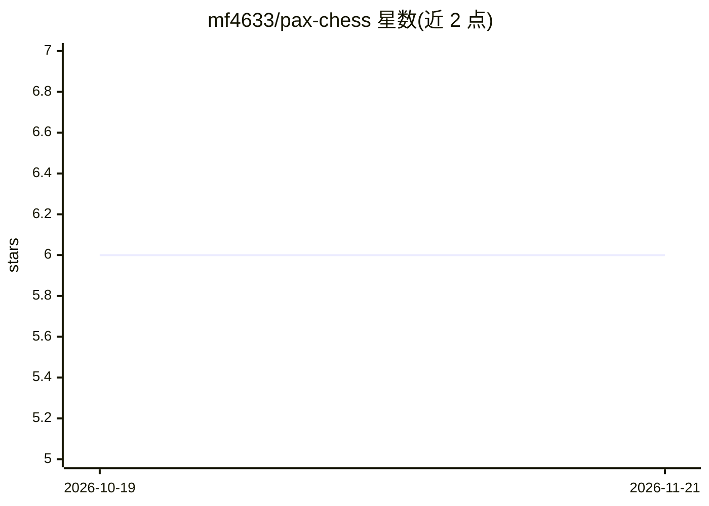

# mf4633/pax-chess

⭐ 6 · HTML · NOASSERTION · 推送 2026-10-06 · [GitHub](https://github.com/mf4633/pax-chess) · [官网](https://mf4633.github.io/pax-chess/) · 个人维护

**致敬 Len Dorfman PAX Chess 的浏览器国际象棋，带败局学习功能**

对 Len Dorfman 2001 年 PAX Chess 的致敬重构：原版 13 MB 开局库（逐字节保留）、棋子位图与界面文本原样复用，引擎、页面与工具为重写的新代码。新增机制包括用梯度下降（Texel 风格调参）以约 90 万 Stockfish 标注局面拟合的子力-位置表，以及败局后回放定位"不可回退点"并将教训存入浏览器 local storage 的学习功能。页面为纯静态无构建步骤，本地运行需以 HTTP 服务目录。

## 筛选速览

| 维度 | 判定 | 备注 |
|---|---|---|
| AI 角色 | `ai-native` | 本体是模型或模型工具 |
| 许可风险 | `none` | NOASSERTION |
| 部署形态 | `desktop` | 安装包/桌面程序 |
| 模型依赖 | — | README 未给出锁定关系 |
| 硬件要求 | — | 无带数字的原话,不猜 |
| 安装摩擦 | `low` | 无编译、无系统依赖或容器化 |
| 成熟度 | — | 结构信号不足 |

## 能力要点

- 逐字节保留原版 13 MB 开局库并直接由引擎读取
- 败局学习：定位不可回退点并生成教训存入 local storage，每次打开页面重放
- Texel 风格调参的子力-位置表，基于约 90 万 Stockfish 标注局面
- 纯静态页面无构建步骤，引擎以 Web Worker 运行

## 适用场景

- 在浏览器中直接对弈这盘致敬版 PAX Chess
- 研究基于开局库的失败学习机制
- 运行 tools 脚本复现调参或与 Stockfish 对测棋力

## 场景标签

 · 领域:游戏/机器学习实验

## 证据(README 行号)

> L21: PAX had a menu item for machine learning. Its switch said *"The feature will be coded after PAX starts learning."* 
> L34: - **Judgement.** Middlegame and endgame piece-square tables, fitted by gradient descent (Texel-style tuning) to Sto
> L35: - **Learning from losses.** After a loss, PAX replays the game and finds the *point of no return*, the last moment 

## 星数曲线

2026-10-19 6 → 2026-11-21 6（+0）

---
*卡片 v1 · prompt 1.4 · 生成 2026-11-20 · 置信度 mid · 依据 README sha `3b9814ecb26a` · [字段定义](../../DATASET.md)*
