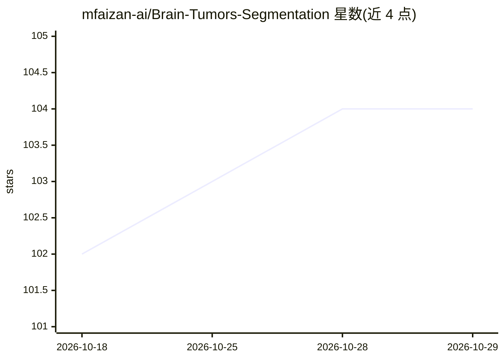

# mfaizan-ai/Brain-Tumors-Segmentation

⭐ 104 · Python · MIT · 推送 2026-03-23 · [GitHub](https://github.com/mfaizan-ai/Brain-Tumors-Segmentation) · 个人维护

**基于 BraTS 数据集的脑肿瘤 MRI 分割训练框架**

面向脑肿瘤分割研究的开源训练与评测代码库：读取 BraTS 2021/2023 多模态 mpMRI NIfTI 数据，提供数据加载、预处理、训练、测试与可视化（GIF）脚本，支持 SegResNet、UNet、SwinUNETR、nnFormer 等 9 种模型架构，并给出在 RTX-4070 上训练 300 epochs 的 Dice/Hausdorff 指标表。数据集需在官网注册申请下载后自行划分训练/验证/测试集。以源码形式提供，推荐 Anaconda 环境 + pip 安装依赖运行。

## 筛选速览

| 维度 | 判定 | 备注 |
|---|---|---|
| AI 角色 | `ai-native` | 本体是模型或模型工具 |
| 许可风险 | `permissive` | MIT |
| 部署形态 | `library` | 以包/库形式分发 |
| 模型依赖 | — | README 未给出锁定关系 |
| 硬件要求 | — | 无带数字的原话,不猜 |
| 安装摩擦 | `low` | 无编译、无系统依赖或容器化 |
| 成熟度 | — | 结构信号不足 |

## 能力要点

- 支持 BraTS 2021/2023 数据集的训练、测试与可视化脚本
- 内置 9 种分割模型架构（SegResNet/SwinUNETR/UNETR/nnFormer 等）
- 各模型训练 300 epochs 的 Dice/Hausdorff/敏感度指标表
- 数据划分为 833 训练 / 209 验证 / 209 测试三份

## 适用场景

- 在 BraTS 数据集上训练脑肿瘤分割模型
- 对比多种分割架构在同一数据集上的表现
- 作为模板构建自己的医学图像分割模型

## 场景标签

`目标检测` `模型训练` · 领域:感知与多模态

## 证据(README 行号)

> L19: This repository utilizes the ```BraTS 2021``` and ```BraTS 2023``` datasets to develop and evaluate both new and ex
> L24: All BraTS23 mpMRI scans are available as NIfTI files and include ```T2 Fluid Attenuated Inversion Recovery (FLAIR)`
> L64: python train.py dataset.dataset_folder=<path to dataset> training.max_epochs=100 training.batch_size=1 training.val

## 星数曲线



2026-10-18 102 → 2026-10-29 104（+2）


---
*卡片 v1 · prompt 1.4 · 生成 2026-10-23 · 置信度 mid · 依据 README sha `9eefd37a3877` · [字段定义](../../DATASET.md)*
