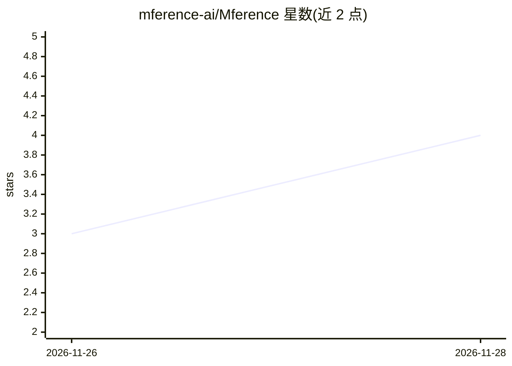

# mference-ai/Mference

⭐ 4 · Swift · NOASSERTION · 推送 2026-11-24 · [GitHub](https://github.com/mference-ai/Mference) · [官网](https://github.com/mference-ai/Mference/blob/main/MTP_WEIGHT_SURGERY_AND_ARCHITECTURE.md) · 组织维护

**Apple Silicon 上运行 Qwen 3.6 35B 的 Swift+Metal 本地推理运行时**

面向 Mac 用户的本地 LLM 推理运行时，围绕 Qwen 3.6 35B-A3B MoE 模型实现：核心常驻权重留在统一内存，路由专家按需从 NVMe SSD 流式读取，以在 16 GB 内存设备上运行 35B 模型。机制包含 MTP+PLD 混合投机解码、无损 INT4 权重缩放变换（surgery）、经 HTTP Range 挂载的临时视觉/PDF 侧车。提供 OpenAI 兼容的本地 HTTP 服务器、CLI 与 SwiftUI 桌面应用，安装通过 git clone 后运行脚本完成。限定 macOS 15+、Metal 3+。

## 筛选速览

| 维度 | 判定 | 备注 |
|---|---|---|
| AI 角色 | `ai-ecosystem` | LLM/agent 周边工具 |
| 许可风险 | `none` | NOASSERTION |
| 部署形态 | `desktop` | 安装包/桌面程序 |
| 模型依赖 | — | README 未给出锁定关系 |
| 硬件要求 | — | 无带数字的原话,不猜 |
| 安装摩擦 | `low` | 无编译、无系统依赖或容器化 |
| 成熟度 | — | 结构信号不足 |

## 能力要点

- 16 GB 统一内存 Mac 上经 NVMe 专家流式运行 35B MoE 模型
- OpenAI 兼容的本地 HTTP/SSE 服务器（/v1/chat/completions，含 image_url/file 多模态）
- MTP + 6-Gram 混合 PLD 投机解码与无损权重 surgery
- 提供桌面应用（Mference.app）、CLI 与本地服务器三种前端

## 适用场景

- 在 16 GB 内存的 Apple Silicon Mac 上本地运行 Qwen 3.6 35B-A3B
- 通过 OpenAI 兼容接口在本地应用中接入该模型
- 对图片和多页 PDF 做本地视觉识别

## 场景标签

`推理引擎` `模型量化` · 领域:训练与推理

## 证据(README 行号)

> L6:  A native Swift + Metal runtime for Qwen 3.6 35B-A3B that streams routed experts from SSD in bounded memory.
> L46: ./mference-ui.sh                      # MferenceServer (:8080) + Open WebUI (:3000)
> L75: - **`MferenceServerCore` / `MferenceServer`** — SwiftNIO OpenAI-compatible HTTP/SSE server (`HTTPServer`, `ServerIn

## 星数曲线

2026-11-26 3 → 2026-11-28 4（+1）

---
*卡片 v1 · prompt 1.4 · 生成 2026-11-26 · 置信度 high · 依据 README sha `97d7ffc82fd2` · [字段定义](../../DATASET.md)*
