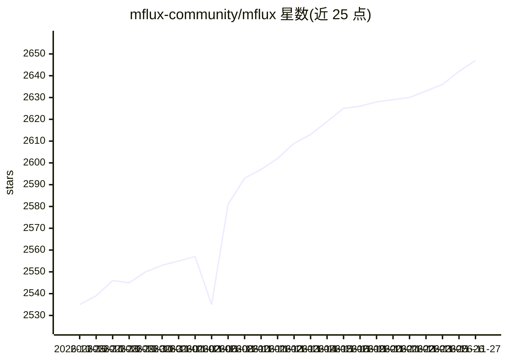

# mflux-community/mflux

⭐ 2,647 · Python · MIT · 推送 2026-11-26 · [GitHub](https://github.com/mflux-community/mflux) · 组织维护

**在 Mac 上以 MLX 本地运行前沿文生图/视频模型**

将多个前沿生成图像模型从 Hugging Face Diffusers/Transformers 逐行移植为 Apple MLX 原生实现，全部从零在 MLX 上实现，仅复用 Transformers 的 tokenizer。提供 CLI 与 Python API，覆盖文本生图、图生图、编辑、LoRA 微调、ControlNet、放大与深度估计等能力，支持量化和本地模型加载。通过 uv 安装，模型首次运行时自动从 Hugging Face 下载。

## 筛选速览

| 维度 | 判定 | 备注 |
|---|---|---|
| AI 角色 | `ai-native` | 本体是模型或模型工具 |
| 许可风险 | `permissive` | MIT |
| 部署形态 | `library` | 以包/库形式分发 |
| 模型依赖 | — | README 未给出锁定关系 |
| 硬件要求 | — | 无带数字的原话,不猜 |
| 安装摩擦 | `medium` | 含编译或系统依赖之一 |
| 成熟度 | — | 结构信号不足 |

## 能力要点

- 支持 Z-Image、FLUX.1/2、Qwen Image、SeedVR2、Depth Pro 等十余个模型家族
- LoRA 支持（多 LoRA、LyCORIS LoKr）与 LoRA 微调训练
- ControlNet、inpainting、放大、深度图提取等图像处理能力
- 量化与本地模型加载，支持 Apple M1 系列 GPU 的 Float16 计算

## 适用场景

- 在 Mac 上本地生成图像而无需云端服务
- 对支持的模型做 LoRA 微调训练
- 对图像做编辑、重绘、放大和深度条件生成

## 场景标签

`图像生成` `视频生成` `图像视频处理` `微调` · 领域:内容生成

## 证据(README 行号)

> L10: Run the latest state-of-the-art generative image models locally on your Mac in native MLX!
> L16: MFLUX is a line-by-line MLX port of several state-of-the-art generative image models from the Huggingface Diffusers

## 星数曲线

2026-10-25 2,535 → 2026-11-27 2,647（+112）

---
*卡片 v1 · prompt 1.4 · 生成 2026-11-23 · 置信度 high · 依据 README sha `321481bb414b` · [字段定义](../../DATASET.md)*
