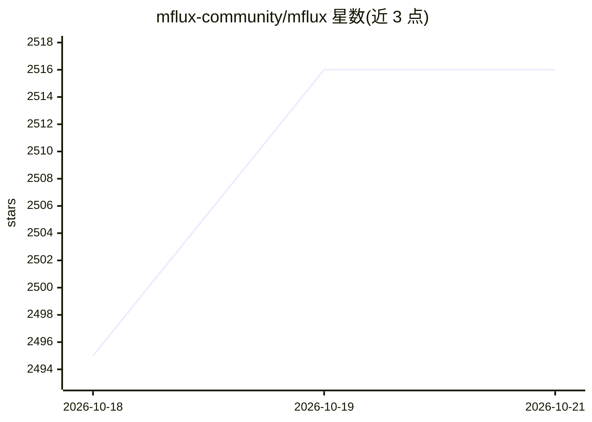

# mflux-community/mflux

⭐ 2,516 · Python · MIT · 推送 2026-10-19 · [GitHub](https://github.com/mflux-community/mflux) · 组织维护

**Mac 本地 MLX 原生运行多种文生图/图生图模型**

在 Apple Silicon 上以 MLX 从零实现的生成式图像模型集合：逐行移植 Hugging Face Diffusers/Transformers 中的 FLUX 系列、Z-Image、Qwen Image、Krea 2、SeedVR2、Depth Pro 等十余个模型家族，仅复用 Transformers 的 tokenizer。通过 uv/pip 安装 CLI（如 mflux-generate-z-image-turbo）或 Python API 生成图像，首次运行自动下载权重；支持 LoRA（含多 LoRA 与 LyCORIS LoKr）、ControlNet、图像编辑、量化与 float16 计算，另支持 LoRA 微调。MIT 许可，由社区团队维护。

## 筛选速览

| 维度 | 判定 | 备注 |
|---|---|---|
| AI 角色 | `ai-native` | 本体是模型或模型工具 |
| 许可风险 | `permissive` | MIT |
| 部署形态 | `library` | 以包/库形式分发 |
| 模型依赖 | — | README 未给出锁定关系 |
| 硬件要求 | — | 无带数字的原话,不猜 |
| 安装摩擦 | `medium` | 含编译或系统依赖之一 |
| 成熟度 | — | 结构信号不足 |

## 能力要点

- MLX 原生实现十余个图像生成模型家族（FLUX/Z-Image/Qwen Image/Krea 2 等）
- CLI 与 Python API 两种使用方式，首次运行自动下载模型
- LoRA 加载与微调、ControlNet、图像编辑、量化、float16 计算支持
- mflux.web 命名空间允许独立分发的 UI 插件，另有 mflux.extras 插件机制

## 适用场景

- 在 Mac 上本地运行文生图/图生图模型生成图像
- 使用 LoRA 或 ControlNet 控制与定制生成结果
- 在本地做 LoRA 微调与图像编辑、超分、深度估计

## 场景标签

`图像生成` `微调` `图像视频处理` · 领域:内容生成

## 证据(README 行号)

> L10: Run the latest state-of-the-art generative image models locally on your Mac in native MLX!
> L16: MFLUX is a line-by-line MLX port of several state-of-the-art generative image models from the Huggingface Diffusers

## 星数曲线

2026-10-18 2,495 → 2026-10-21 2,516（+21）

---
*卡片 v1 · prompt 1.4 · 生成 2026-10-21 · 置信度 high · 依据 README sha `5f645e45ec6c` · [字段定义](../../DATASET.md)*
