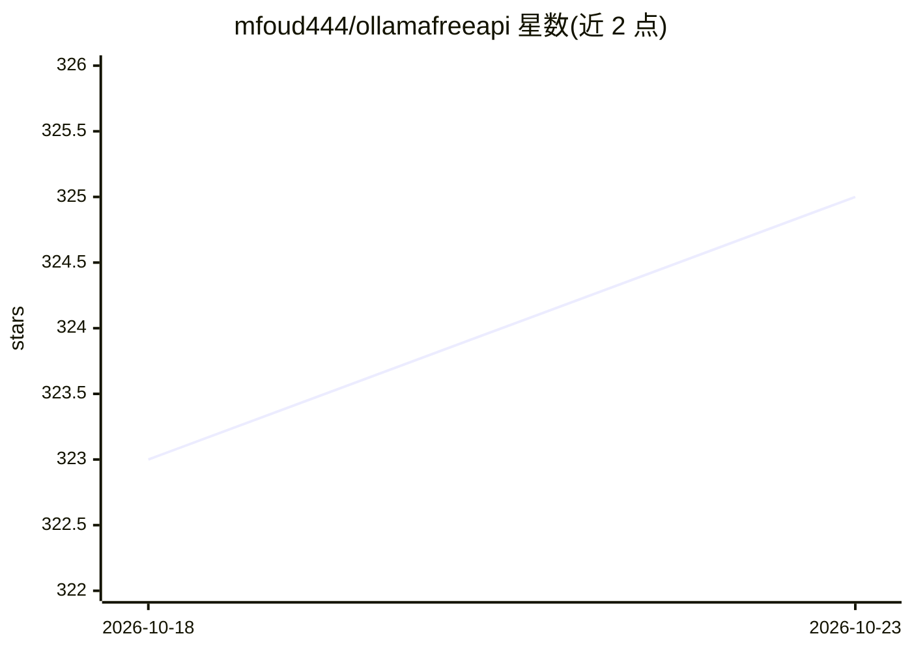

# mfoud444/ollamafreeapi

⭐ 325 · Python · 推送 2026-10-06 · [GitHub](https://github.com/mfoud444/ollamafreeapi) · 个人维护

**免费访问托管 Ollama 服务器的 LLM API 客户端库**

基于 ollama-python 构建的 Python 客户端库，连接其运营的分布式社区 Ollama 服务器节点：提供 16 个已验证模型（gemma、llama、qwen 三个家族）的统一访问，支持流式/非流式生成、模型列表查询、服务器位置查询等 API。节点自动负载均衡并做实时可用性检查，免费层无需 API key。限制：模型与端点由运营方管理，可用性依赖其 6 个服务器节点。

## 筛选速览

| 维度 | 判定 | 备注 |
|---|---|---|
| AI 角色 | `ai-ecosystem` | LLM/agent 周边工具 |
| 许可风险 | `none` | — |
| 部署形态 | `library` | 以包/库形式分发 |
| 模型依赖 | — | README 未给出锁定关系 |
| 硬件要求 | — | 无带数字的原话,不猜 |
| 安装摩擦 | `low` | 无编译、无系统依赖或容器化 |
| 成熟度 | — | 结构信号不足 |

## 能力要点

- 零配置访问托管 Ollama 服务器上的已验证模型（16 个活跃模型）
- 自动负载均衡与服务器选择、实时可用性检查
- 支持流式与非流式调用、模型列表与服务器位置查询 API
- 基于 ollama-python 构建，免费层无需 API key

## 适用场景

- 开发者免配置试用 LLaMA、DeepSeek、Qwen 等开源模型
- 在 Termux/Android 环境通过 F-Droid 安装使用
- 通过 Python 代码快速接入分布式 Ollama 节点做文本生成

## 场景标签

`模型网关` · 领域:Agent 开发

## 证据(README 行号)

> L12: OllamaFreeAPI provides free access to leading open-source LLMs including:
> L83: Our free API is powered by distributed community nodes:
> L93: api.list_models()

## 星数曲线

2026-10-18 323 → 2026-10-23 325（+2）

---
*卡片 v1 · prompt 1.4 · 生成 2026-10-21 · 置信度 high · 依据 README sha `ed345b70f74a` · [字段定义](../../DATASET.md)*
