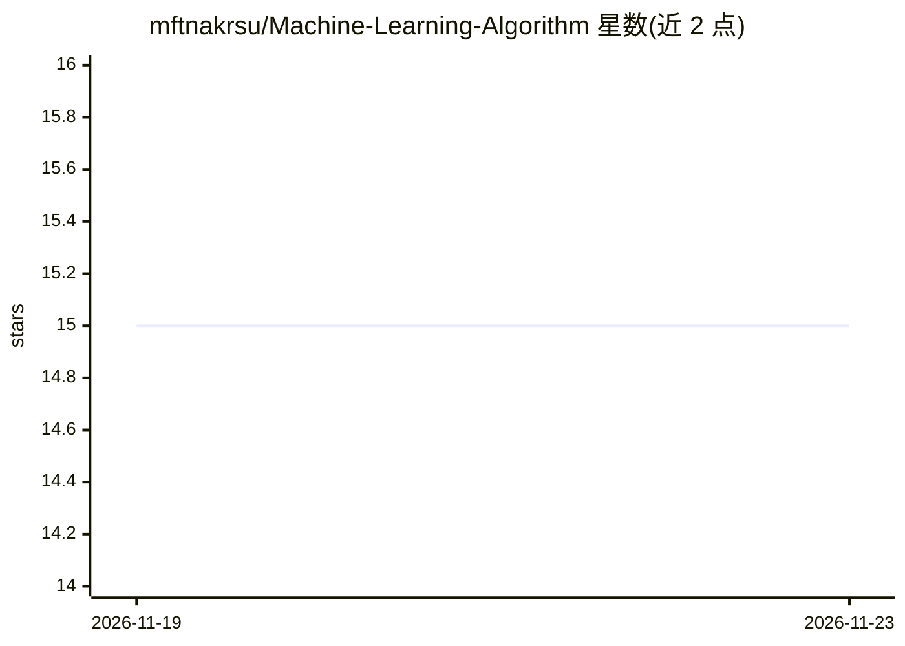

# mftnakrsu/Machine-Learning-Algorithm

⭐ 15 · Jupyter Notebook · 推送 2026-11-18 · [GitHub](https://github.com/mftnakrsu/Machine-Learning-Algorithm) · 个人维护

**回归与分类算法的机器学习代码集**

仓库标题为 Machine-Learning-Algorithm，主题标签覆盖数据科学、机器学习、监督学习与无监督学习，描述为回归与分类算法。README 正文仅含标题一行，未提供功能说明、安装步骤、运行方式或使用对象等可验证信息，编目仅能基于仓库元数据。

## 筛选速览

| 维度 | 判定 | 备注 |
|---|---|---|
| AI 角色 | `ai-native` | 本体是模型或模型工具 |
| 许可风险 | `none` | — |
| 部署形态 | `None` |  |
| 模型依赖 | — | README 未给出锁定关系 |
| 硬件要求 | — | 无带数字的原话,不猜 |
| 安装摩擦 | `low` | 无编译、无系统依赖或容器化 |
| 成熟度 | — | 结构信号不足 |

## 能力要点

- 主题标签覆盖监督学习与无监督学习
- 内容为回归与分类算法实现

## 适用场景

- 查找回归与分类算法的参考实现
- 作为机器学习入门练习材料

## 场景标签

 · 领域:机器学习/算法实现

## 证据(README 行号)

> L1: # Machine-Learning-Algorithm

## 星数曲线

2026-11-19 15 → 2026-11-23 15（+0）

---
*卡片 v1 · prompt 1.4 · 生成 2026-11-19 · 置信度 low · 依据 README sha `5e9df17e510f` · [字段定义](../../DATASET.md)*
