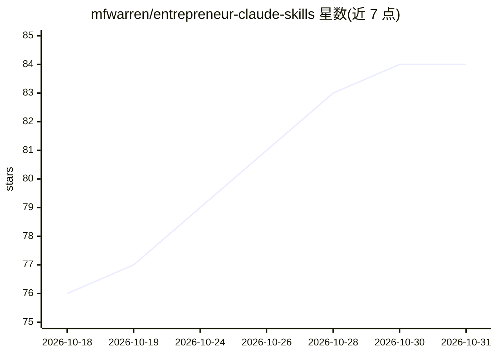

# mfwarren/entrepreneur-claude-skills

⭐ 84 · HTML · MIT · 推送 2026-02-08 · [GitHub](https://github.com/mfwarren/entrepreneur-claude-skills) · [官网](https://mattwarren.co) · 个人维护

**面向创始人的 Claude Code 创业技能包（24 个技能，6 类）**

由创始人 Matt Warren 维护的创业技能包，提供 24 个 SKILL.md 格式的技能，覆盖营销增长、销售营收、产品战略、运营系统、财务融资、领导力 6 大类，含文案写作、冷启动外联、定价策略、财务建模、融资策略等。技能按请求自动激活，兼容 Claude Code、Cursor、Windsurf、VS Code + Copilot 等 AI 编码代理。提供 6 种安装方式：插件市场、npx CLI、单个技能安装、通用安装器、git clone 与 git submodule。MIT 许可。

## 筛选速览

| 维度 | 判定 | 备注 |
|---|---|---|
| AI 角色 | `ai-knowledge` | 知识聚合/清单类 |
| 许可风险 | `permissive` | MIT |
| 部署形态 | `library` | 以包/库形式分发 |
| 模型依赖 | — | README 未给出锁定关系 |
| 硬件要求 | — | 无带数字的原话,不猜 |
| 安装摩擦 | `low` | 无编译、无系统依赖或容器化 |
| 成熟度 | — | 结构信号不足 |

## 能力要点

- 24 个技能分 6 类组织，每个含 SKILL.md、文档、示例与参考框架
- 兼容 Claude Code、Cursor、Windsurf、VS Code + Copilot 等 AI 代理
- 6 种安装途径：插件市场 / npx skills / 通用安装器 / git clone / submodule

## 适用场景

- 为 AI 编码代理配备营销、销售、融资等创业场景技能
- 创始人用自然语言请求触发对应技能（如冷邮件序列、定价分析）
- 按需单独安装某个技能到现有项目

## 场景标签

`AI 写作` `提示工程` · 领域:Agent 开发

## 证据(README 行号)

> L3: Production-ready skill packages for Claude Code and AI coding agents. The best-of-the-best skills for building, grow
> L5: **24 skills across 6 categories** | **Built for founders, by a founder** | **Works with Claude Code, Cursor, Windsur
> L122: skills/category/skill-name/

## 星数曲线

2026-10-18 76 → 2026-10-31 84（+8）

---
*卡片 v1 · prompt 1.4 · 生成 2026-10-24 · 置信度 high · 依据 README sha `9c5a6b97ec05` · [字段定义](../../DATASET.md)*
