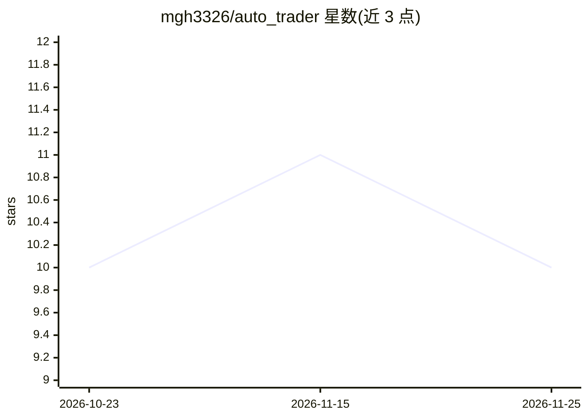

# mgh3326/auto_trader

⭐ 10 · Python · MIT · 推送 2026-11-24 · [GitHub](https://github.com/mgh3326/auto_trader) · 个人维护

**LLM 代理在确定性安全层下自动交易 KR/US 股票与加密货币**

一个 AI 自动交易系统：运行时以 FastAPI + PostgreSQL + Redis 提供确定性的数据、订单与安全层，判断由通过 MCP（streamable-http）连接的进程外 LLM agent 完成，暴露 140+ 工具。安全机制包括默认 dry_run 的 fail-closed 订单、preview→approval_hash→place 校验、确定性幂等键、fill-evidence 对账记账、以及订单→成交→复盘→forecast 的学习循环。支持韩国股市、美国股市与加密货币的实盘与多家券商模拟环境；实盘功能默认全部关闭，需环境变量开关与逐笔 confirm。提供 React Web 仪表盘。作者声明为个人项目、非投资建议。

## 筛选速览

| 维度 | 判定 | 备注 |
|---|---|---|
| AI 角色 | `ai-ecosystem` | LLM/agent 周边工具 |
| 许可风险 | `permissive` | MIT |
| 部署形态 | `self-host` | docker 或自建部署 |
| 模型依赖 | — | README 未给出锁定关系 |
| 硬件要求 | — | 无带数字的原话,不猜 |
| 安装摩擦 | `low` | 无编译、无系统依赖或容器化 |
| 成熟度 | — | 结构信号不足 |

## 能力要点

- 140+ MCP 工具（查询/下单/对账/复盘）以 streamable-http 服务器暴露
- fail-closed 订单：dry_run 默认、approval_hash（TTL 5 分钟）重算验证、幂等键防重复下单
- fill-evidence 门控：仅凭券商 order-id 成交证据的 reconcile 确认成交与损益
- 订单→成交→日志→forecast→复盘以 correlation_id 关联，附校准仪表盘

## 适用场景

- 让 LLM agent 在安全约束下执行 KR/US/加密货币的实盘或模拟交易
- 构建带审批门与幂等下单的自动化交易运行时
- 通过 forecast 校准仪表盘回顾 agent 预测与实际结果

## 场景标签

`金融量化` · 领域:学习与行业

## 证据(README 行号)

> L3: **LLM 에이전트가 시장 분석부터 주문 실행, 체결 확정, 매매 회고까지 수행하는 AI 자동매매 시스템.**
> L5: 런타임은 결정론적인 데이터·주문·안전 레이어만 담당하고, 판단(LLM)은 MCP(Model Context Protocol)로 연결된 **프로세스 밖의 에이전트**가 수행합니다. 국내주식·미국주식·암호화폐를 실
> L24: 런타임 코드는 in-process LLM provider를 import하지 않습니다(정적 가드 테스트가 `app/**` 전체를 스캔해 강제). 판단은 MCP로 연결된 에이전트가, 데이터 수집·주문 실행·검증

## 星数曲线

2026-10-23 10 → 2026-11-25 10（+0）

---
*卡片 v1 · prompt 1.4 · 生成 2026-11-18 · 置信度 high · 依据 README sha `0d70d5ce6742` · [字段定义](../../DATASET.md)*
