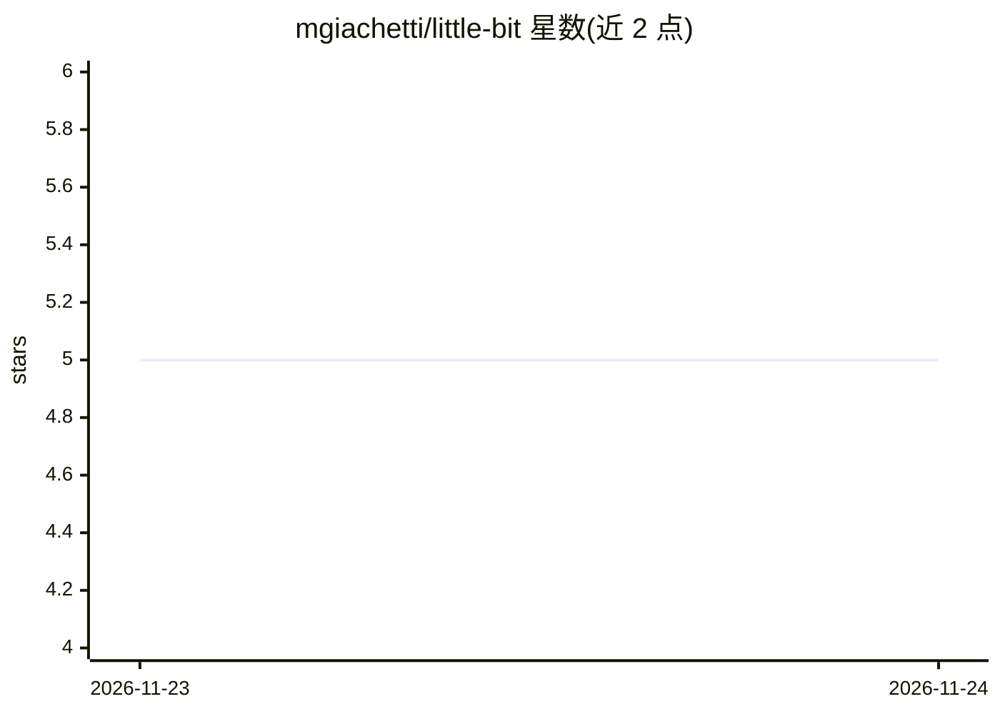

# mgiachetti/little-bit

⭐ 5 · Python · MIT · 推送 2026-10-23 · [GitHub](https://github.com/mgiachetti/little-bit) · 个人维护

**LLM 亚1比特压缩方法的 PyTorch 复现研究库**

从零复现 LittleBit（NeurIPS 2025）与 LittleBit-2 的 Joint-ITQ 初始化（ICML 2026）：通过二值化低秩分解把 transformer 线性层压到亚 1 比特每权重，并针对 Qwen3 等带 attention-sink 激活的模型提出 sink-aware 蒸馏损失。含 train.py 训练脚本（BPW 目标、初始化方式、C4/WikiText-2 训练配比、断点续训等参数）与 convert.py 换层/体积报告工具。作者声明为独立复现、研究级代码，尚无位打包推理内核，仅做困惑度评估。

## 筛选速览

| 维度 | 判定 | 备注 |
|---|---|---|
| AI 角色 | `ai-native` | 本体是模型或模型工具 |
| 许可风险 | `permissive` | MIT |
| 部署形态 | `library` | 以包/库形式分发 |
| 模型依赖 | — | README 未给出锁定关系 |
| 硬件要求 | — | 无带数字的原话,不猜 |
| 安装摩擦 | `low` | 无编译、无系统依赖或容器化 |
| 成熟度 | `idea` | |

## 能力要点

- Dual-SVID 与 Joint-ITQ 两种二值化初始化实现
- sink-aware 蒸馏损失缓解 attention-sink 模型的高困惑度
- GTX 1080 (8GB) 上 107M token 可训练，Qwen3-0.6B 压至 0.55 BPW
- 训练块体积从约 840 MB 降至约 29 MB（存储公式估算）

## 适用场景

- 在有限显存上研究亚1比特量化的训练流程
- 复现论文对比 Dual-SVID 与 Joint-ITQ 初始化的效果
- 对自己关注的注意力机制模型测试 sink-aware 损失

## 场景标签

`模型量化` · 领域:训练与推理

## 证据(README 行号)

> L3: A from-scratch PyTorch implementation of **sub-1-bit LLM compression** via binarized low-rank factorization: LittleB
> L30: with low-rank latent factors `U, V` binarized on the fly and FP16 scales `h, g, ℓ`. The rank is chosen to hit a tar
> L65: This is research code: single runs, perplexity-only evaluation, and no bit-packed inference kernel yet. Checkpoints

## 星数曲线

2026-11-23 5 → 2026-11-24 5（+0）

---
*卡片 v1 · prompt 1.4 · 生成 2026-11-23 · 置信度 high · 依据 README sha `5a5844912dc0` · [字段定义](../../DATASET.md)*
