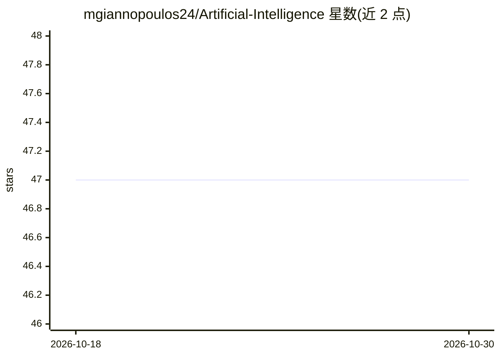

# mgiannopoulos24/Artificial-Intelligence

⭐ 47 · Python · 推送 2026-10-10 · [GitHub](https://github.com/mgiannopoulos24/Artificial-Intelligence) · 个人维护

**UC Berkeley CS 188 课程 AI 项目解答集合**

收录 UC Berkeley Artificial Intelligence (CS 188) 课程各学期项目的解答代码，覆盖搜索算法、多智能体系统、强化学习与机器学习等主题（标签涉及 minimax、expectimax、alpha-beta 剪枝、决策树、粒子滤波、Pacman 等）。面向修读该课程或练习经典 AI 算法的学习者，以 Git 仓库形式提供，无独立安装流程说明。

## 筛选速览

| 维度 | 判定 | 备注 |
|---|---|---|
| AI 角色 | `ai-knowledge` | 知识聚合/清单类 |
| 许可风险 | `none` | — |
| 部署形态 | `None` |  |
| 模型依赖 | — | README 未给出锁定关系 |
| 硬件要求 | — | 无带数字的原话,不猜 |
| 安装摩擦 | `low` | 无编译、无系统依赖或容器化 |
| 成熟度 | — | 结构信号不足 |

## 能力要点

- 多学期 CS 188 项目解答
- 覆盖搜索、多智能体、强化学习、机器学习主题

## 适用场景

- 修读 CS 188 时参考项目解法
- 对照学习 minimax/expectimax、粒子滤波等经典 AI 算法实现

## 场景标签

 · 领域:计算机科学教育

## 证据(README 行号)

> L3: This repository contains solutions for the projects of the **Artificial Intelligence (CS 188)** course at UC Berkele

## 星数曲线

2026-10-18 47 → 2026-10-30 47（+0）

---
*卡片 v1 · prompt 1.4 · 生成 2026-10-25 · 置信度 mid · 依据 README sha `431c0e4f5258` · [字段定义](../../DATASET.md)*
