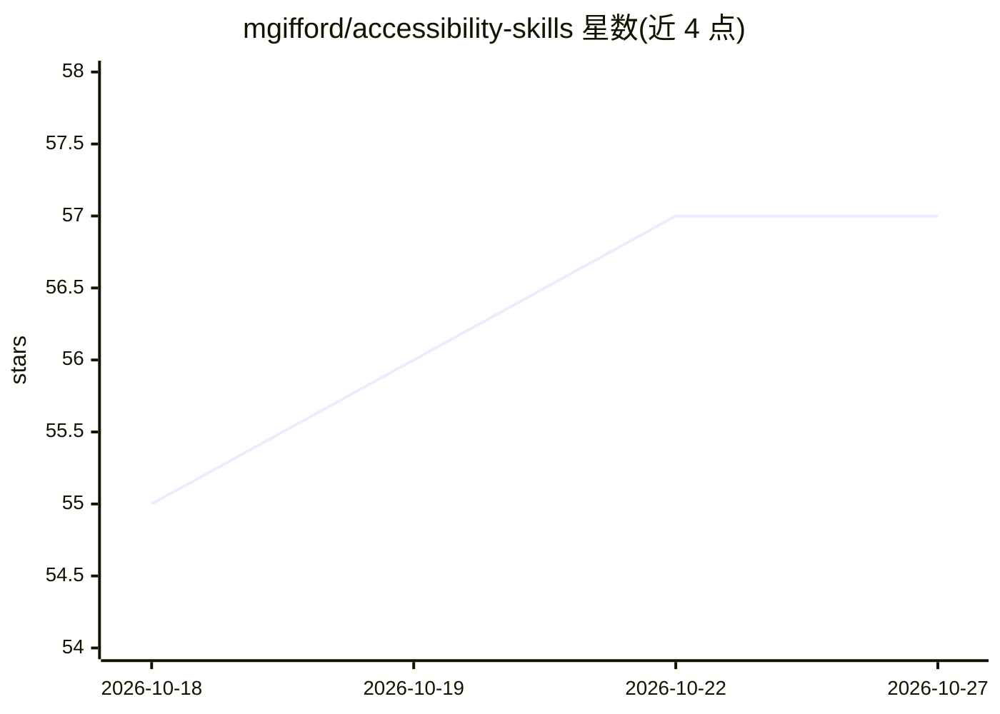

# mgifford/accessibility-skills

⭐ 57 · JavaScript · AGPL-3.0 · 推送 2026-09-15 · [GitHub](https://github.com/mgifford/accessibility-skills) · 个人维护

**面向 AI agent 的无障碍（a11y）技能集合，覆盖约 30 个主题**

从 examples/ 目录的最佳实践文档提炼出 agent 可执行的规则技能，覆盖表单、颜色对比、SVG、键盘、ARIA live regions、CI/CD 等无障碍主题，每个技能含必需模式、ARIA 用法与完成定义清单。examples/ 为唯一事实来源，通过 SYNC.md 记录来源与同步 commit，并由 GitHub Actions 检查漂移。安装方式包括 npx skills CLI、Claude Code 全局 .skill 归档、Claude.ai 项目指令、AGENTS.md 及 Cursor/Copilot 配置引用；另含 evals 评估清单与 npm 脚本用于校验模型输出。

## 筛选速览

| 维度 | 判定 | 备注 |
|---|---|---|
| AI 角色 | `ai-knowledge` | 知识聚合/清单类 |
| 许可风险 | `viral` | AGPL-3.0 |
| 部署形态 | `library` | 以包/库形式分发 |
| 模型依赖 | — | README 未给出锁定关系 |
| 硬件要求 | — | 无带数字的原话,不猜 |
| 安装摩擦 | `low` | 无编译、无系统依赖或容器化 |
| 成熟度 | — | 结构信号不足 |

## 能力要点

- 约 30 个主题技能均从 examples/ 最佳实践文档提炼
- SYNC.md + GitHub Actions 维护技能与源文档的同步检查
- 提供 evals 评估清单及 npm run run:evals 模型输出校验
- 支持 npx skills CLI、Claude Code、Claude.ai、AGENTS.md、Cursor/Copilot 多种接入方式

## 适用场景

- 给 Claude/Cursor/Copilot 等 AI agent 注入 WCAG 无障碍开发规则
- 在项目中通过 AGENTS.md 引用表单、配色、SVG 等专项无障碍技能
- 用 evals 清单评估 AI 输出是否符合无障碍规则

## 场景标签

`模型评测` `提示工程` · 领域:Agent 开发

## 证据(README 行号)

> L3: AI agent skills derived from `examples/` best practice guides.
> L12: |Skill|Derived from|Install|

## 星数曲线

2026-10-18 55 → 2026-10-27 57（+2）

---
*卡片 v1 · prompt 1.4 · 生成 2026-10-24 · 置信度 high · 依据 README sha `36f535dd3b89` · [字段定义](../../DATASET.md)*
