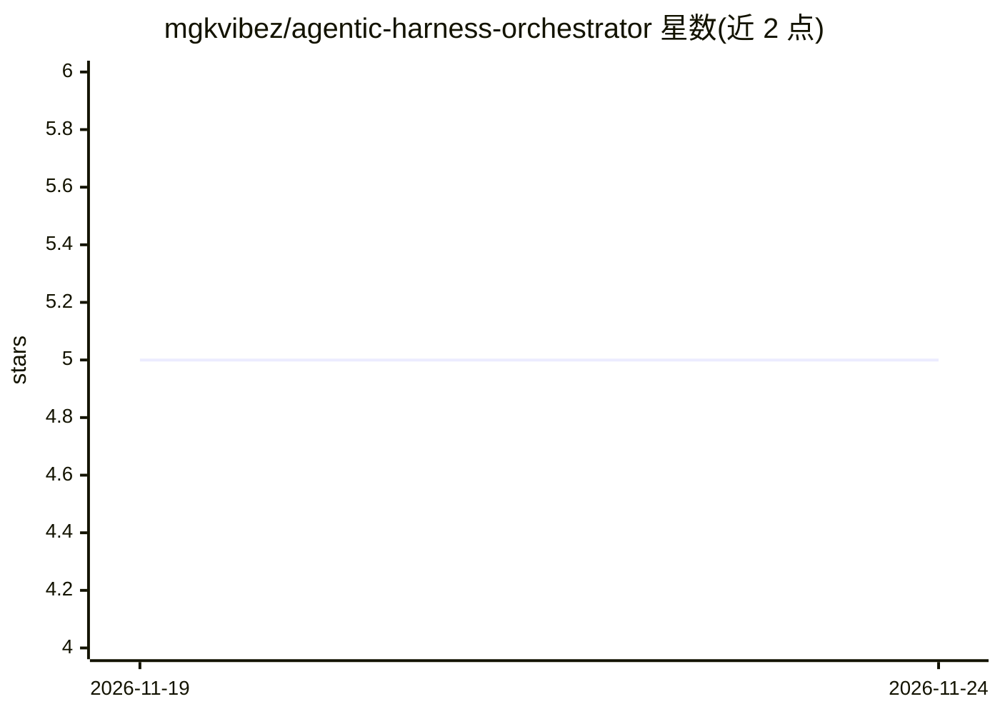

# mgkvibez/agentic-harness-orchestrator

⭐ 5 · Python · MIT · 推送 2026-10-31 · [GitHub](https://github.com/mgkvibez/agentic-harness-orchestrator) · 个人维护

**为开发者按子任务路由到不同模型的 LLM 编排器**

从零实现的 Python 编排器：triage 判定单 agent 还是多 agent，planner 拆解步骤，blackboard 在 agent 间传递产物，所有决策写入带 token 与成本的 append-only trace。控制流 JSON 严格校验，失败有一次修复机会后走安全回退路径。三条上限（步数、成本、墙钟）按步强制执行，成本采用先报价预留后调用的机制，未知定价按保守费率计。经 pipx 安装，提供离线 demo。

## 筛选速览

| 维度 | 判定 | 备注 |
|---|---|---|
| AI 角色 | `ai-ecosystem` | LLM/agent 周边工具 |
| 许可风险 | `permissive` | MIT |
| 部署形态 | `library` | 以包/库形式分发 |
| 模型依赖 | — | README 未给出锁定关系 |
| 硬件要求 | — | 无带数字的原话,不猜 |
| 安装摩擦 | `low` | 无编译、无系统依赖或容器化 |
| 成熟度 | — | 结构信号不足 |

## 能力要点

- 按子任务路由到不同模型，triage/planning 用低价模型
- 黑板共享状态与 append-only 可审计 trace（含 token、成本、sha256）
- 步骤/成本/时间三重上限与先预留后调用的预算机制
- 严格 JSON 契约，校验失败回退到单 agent 安全路径

## 适用场景

- 将一个任务拆分后按各步骤特点分配不同价位的模型以控制成本
- 需要可审计 trace 与成本核算的多 agent 流水线
- 对第三方端点做契约合规探测与模型可用性验证

## 场景标签

`Agent 框架` `多智能体` · 领域:Agent 开发

## 证据(README 行号)

> L3: **One task in, the right model per sub-task out, with the receipts.** A from-scratch orchestrator: triage decides wh
> L9: Built as the code behind the *Agentic Harness Orchestrator* blueprint: a Python while loop over a shared state dicti
> L34: |LLM-based routing with a cheap model|Triage and planning both go to `registry.cheapest_with("cheap")`, never the f

## 星数曲线

2026-11-19 5 → 2026-11-24 5（+0）

---
*卡片 v1 · prompt 1.4 · 生成 2026-11-21 · 置信度 high · 依据 README sha `f61b50454f83` · [字段定义](../../DATASET.md)*
