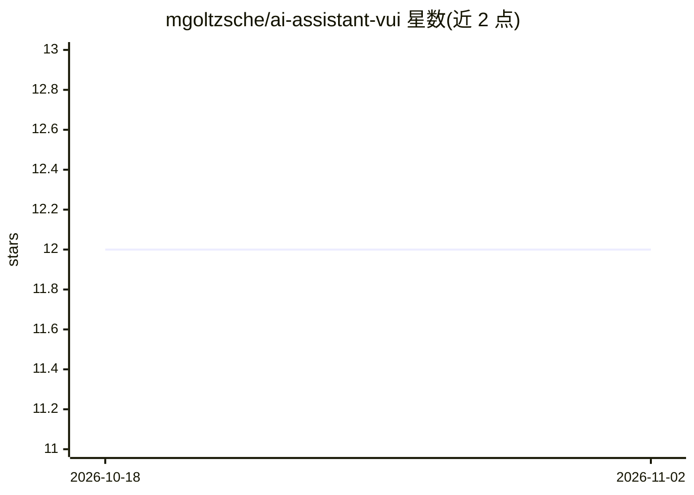

# mgoltzsche/ai-assistant-vui

⭐ 12 · Go · Apache-2.0 · 推送 2026-10-31 · [GitHub](https://github.com/mgoltzsche/ai-assistant-vui) · 个人维护

**本地化语音 AI 助手界面：通过对话与可调用工具的 agent 交互**

实验性语音用户界面，作为 OpenAI API 兼容服务器（默认 LocalAI 本地部署）的客户端，提供聊天补全、STT/TTS 能力；内置 silero-vad 做语音活动检测，通过 whisper STT 输出匹配实现可配置唤醒词。助手可决定运行 Docker 化的预配置工具与现实世界交互（如调整音量）。提供 Go 编写的 Web 应用（跨平台）与终端应用（仅 Linux）两种形态，构建与运行均基于 Make/Docker。已知限制包括 LocalAI 函数调用重复 bug 的规避处理、上下文仅保留最近一轮对话。

## 筛选速览

| 维度 | 判定 | 备注 |
|---|---|---|
| AI 角色 | `ai-native` | 本体是模型或模型工具 |
| 许可风险 | `permissive` | Apache-2.0 |
| 部署形态 | `None` |  |
| 模型依赖 | — | README 未给出锁定关系 |
| 硬件要求 | `gpu-8g` | |
| 安装摩擦 | `low` | 无编译、无系统依赖或容器化 |
| 成熟度 | `idea` | |

## 能力要点

- OpenAI API 兼容客户端，默认配合本地 LocalAI 服务器
- 内置 silero-vad 语音活动检测，仅对含语音的音频做 STT
- AI 可调用 Docker 化工具与现实世界交互
- 可配置唤醒词（通过 whisper STT 输出匹配）

## 适用场景

- 双手不便时通过语音控制电脑或 IoT 设备
- 本地部署语音 AI 助手，避免音频数据发送到第三方服务器
- 通过语音让 AI 运行预配置的容器化工具

## 场景标签

`语音 Agent` `AI 助手` · 领域:对话与助手

## 证据(README 行号)

> L4: An experimental voice user interface (VUI) to interact with an AI assistant.
> L7: To answer a user request it can decide to use tools in form of running configurable, dockerized functions.
> L14: For chat completion, speech-to-text (STT) and text-to-speech (TTS) capabilities the OpenAI API-compatible server is

## 星数曲线

2026-10-18 12 → 2026-11-02 12（+0）

---
*卡片 v1 · prompt 1.4 · 生成 2026-11-01 · 置信度 high · 依据 README sha `b817001e713c` · [字段定义](../../DATASET.md)*
