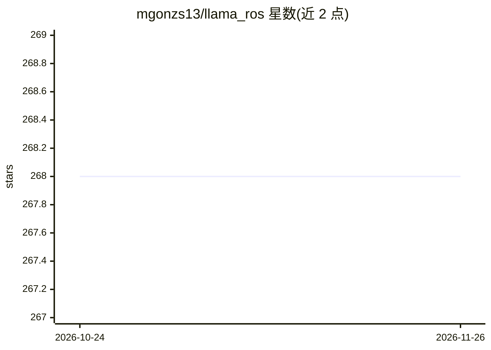

# mgonzs13/llama_ros

⭐ 268 · C++ · MIT · 推送 2026-11-20 · [GitHub](https://github.com/mgonzs13/llama_ros) · [官网](https://mgonzs13.github.io/llama_ros/) · 个人维护

**将 llama.cpp 集成到 ROS 2 的机器人 LLM 接入包**

一组 ROS 2 包，用于在 ROS 2 中运行 llama.cpp，支持 GGUF 格式的 LLM、VLM、音频语言、嵌入与重排序模型；提供 OpenAI 兼容的 chat completions 接口（含工具调用、推理、流式输出）、speculative decoding、GBNF 语法与 LoRA 实时切换。支持 Humble/Iron/Jazzy 等多个 ROS 2 发行版，安装方式含原生编译、CUDA 构建与 Docker；文档覆盖 CLI、ROS 参数、接口与 LangChain 示例。面向机器人开发者。

## 筛选速览

| 维度 | 判定 | 备注 |
|---|---|---|
| AI 角色 | `ai-ecosystem` | LLM/agent 周边工具 |
| 许可风险 | `permissive` | MIT |
| 部署形态 | `None` |  |
| 模型依赖 | local-ok | 支持本地模型 |
| 硬件要求 | — | 无带数字的原话,不猜 |
| 安装摩擦 | `medium` | 含编译或系统依赖之一 |
| 成熟度 | — | 结构信号不足 |

## 能力要点

- 在 ROS 2 中运行 GGUF LLM/VLM/音频/嵌入/重排序模型
- OpenAI 兼容接口，支持工具调用、reasoning 与流式输出
- 支持 GBNF 语法与 LoRA 实时切换
- 覆盖 5 个 ROS 2 发行版，提供 Docker 镜像与 CUDA 构建

## 适用场景

- 为机器人接入本地大模型生成对话回复
- 在 ROS 2 中调用嵌入与重排序做检索
- 结合 whisper_ros 搭建语音对话机器人

## 场景标签

`推理引擎` `聊天机器人` `多模态` · 领域:对话与助手

## 证据(README 行号)

> L3: This repository provides a set of ROS 2 packages to integrate llama.cpp into ROS 2. Using the llama_ros packages, yo
> L35: |Installation|Native installation, CUDA build and Docker|

## 星数曲线

2026-10-24 268 → 2026-11-26 268（+0）

---
*卡片 v1 · prompt 1.4 · 生成 2026-11-26 · 置信度 high · 依据 README sha `946181e90bff` · [字段定义](../../DATASET.md)*
