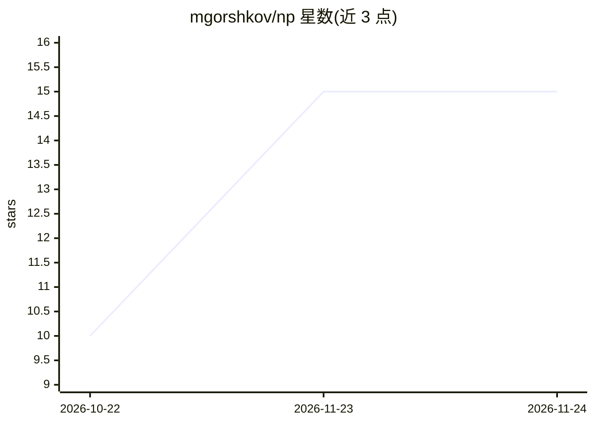

# mgorshkov/np

⭐ 15 · C++ · MIT · 推送 2026-11-16 · [GitHub](https://github.com/mgorshkov/np) · [官网](https://mgorshkov.github.io/np) · 个人维护

**C++ 版 NumPy 风格 N 维数组库，支持 CUDA GPU 与 SIMD 加速**

以 C++20 实现的 N 维数组与数值计算库，提供 NumPy 风格接口，支持 CPU（AVX2/AVX512/AMX SIMD 与多线程）和 CUDA GPU 加速，内置 Tikhonov 正则化 EVD、LSQR、MRRR、SVD、QR 等线性代数求解器。通过 CMake 构建，脚本一键编译库与单元测试，附蒙特卡洛与最小二乘示例，需 gcc 13+/clang 14+/VS2019+，使用 CUDA 优化需 nvcc 12+ 与 NVIDIA 驱动。作者另维护 pd、scipy、sklearn 三个 C++ 姊妹仓库。

## 筛选速览

| 维度 | 判定 | 备注 |
|---|---|---|
| AI 角色 | `ai-native` | 本体是模型或模型工具 |
| 许可风险 | `permissive` | MIT |
| 部署形态 | `None` |  |
| 模型依赖 | — | README 未给出锁定关系 |
| 硬件要求 | — | 无带数字的原话,不猜 |
| 安装摩擦 | `high` | 编译与系统依赖俱全 |
| 成熟度 | — | 结构信号不足 |

## 能力要点

- CUDA GPU + SIMD（AVX2/AVX512/AMX）CPU 加速与多线程
- 内置 Tikhonov 正则化 EVD、LSQR、MRRR、SVD、QR 求解器
- 提供蒙特卡洛与最小二乘完整构建示例与 Python/numpy 对比数据
- CMake 安装与 cmake 文档构建目标

## 适用场景

- 在 C++ 工程中做 N 维数组数值计算而无需引入 Python
- 求解大规模最小二乘与特征值问题
- 在 NVIDIA GPU 上加速线性代数计算

## 场景标签

 · 领域:科学计算/数值库

## 证据(README 行号)

> L6: ⚡ NumPy-style arrays in C++ | CUDA GPU + SIMD (AVX2/AVX512/AMX) CPU | Tikhonov Regularized EVD, LSQR, MRRR, SVD, QR,
> L9: **High-performance N-dimensional arrays** with CPU/GPU/Multithreading acceleration and built-in ML algorithms (Tikho

## 星数曲线

2026-10-22 10 → 2026-11-24 15（+5）

---
*卡片 v1 · prompt 1.4 · 生成 2026-11-19 · 置信度 high · 依据 README sha `0bad5cf70e6e` · [字段定义](../../DATASET.md)*
