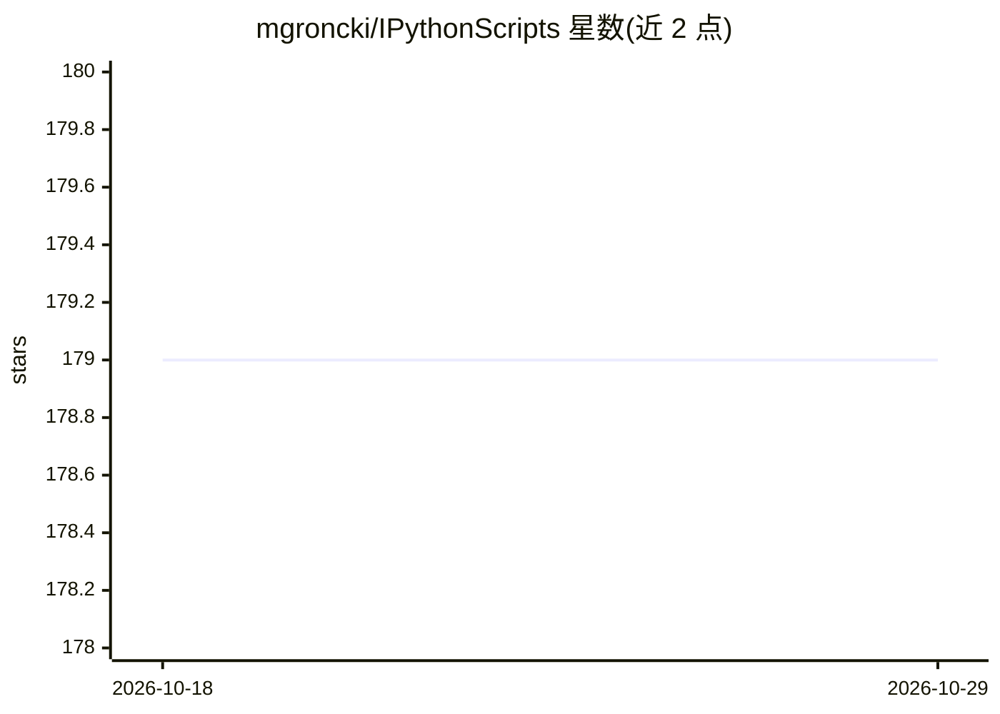

# mgroncki/IPythonScripts

⭐ 179 · Jupyter Notebook · BSD-3-Clause · 推送 2026-02-28 · [GitHub](https://github.com/mgroncki/IPythonScripts) · [官网](https://www.ipythonquant.wordpress.com) · 个人维护

**量化金融 Python/QuantLib 教学笔记本集合：定价、xVA、对冲、机器学习**

作者博客（ipythonquant.wordpress.org）配套的 IPython/Jupyter 笔记本教程集合，主题覆盖衍生品定价、xVA、对冲、组合优化、蒙特卡洛模拟及机器学习与深度学习在量化金融中的应用，使用 Python 与 QuantLib。README 仅提供仓库简介，未给出安装命令或依赖清单，需自行下载笔记本运行。适合量化金融学习者与从业者参考实践。

## 筛选速览

| 维度 | 判定 | 备注 |
|---|---|---|
| AI 角色 | `ai-knowledge` | 知识聚合/清单类 |
| 许可风险 | `permissive` | BSD-3-Clause |
| 部署形态 | `None` |  |
| 模型依赖 | — | README 未给出锁定关系 |
| 硬件要求 | — | 无带数字的原话,不猜 |
| 安装摩擦 | `low` | 无编译、无系统依赖或容器化 |
| 成熟度 | — | 结构信号不足 |

## 能力要点

- Jupyter 笔记本形式的量化金融教程
- 覆盖定价、xVA、对冲、组合优化、蒙特卡洛模拟
- 包含机器学习与深度学习应用示例

## 适用场景

- 学习衍生品定价与 xVA 计算的 Python/QuantLib 实现
- 参考蒙特卡洛模拟与对冲策略的代码示例
- 了解机器学习在量化金融中的应用

## 场景标签

`金融量化` `教程课程` · 领域:学习与行业

## 证据(README 行号)

> L3: Here you find my IPython (Jupyter) notebooks from my blog (ipythonquant.wordpress.org).

## 星数曲线

2026-10-18 179 → 2026-10-29 179（+0）

---
*卡片 v1 · prompt 1.4 · 生成 2026-10-22 · 置信度 mid · 依据 README sha `235af298fc8b` · [字段定义](../../DATASET.md)*
