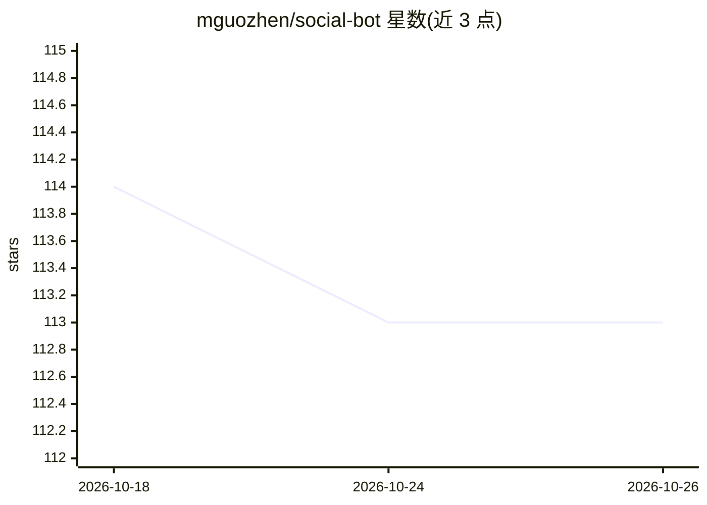

# mguozhen/social-bot

⭐ 113 · Python · 推送 2026-04-13 · [GitHub](https://github.com/mguozhen/social-bot) · 个人维护

**Reddit/X 自动回复机器人：用 Claude 生成获客评论**

面向产品推广者的社交平台自动回复机器人：在 Reddit 子版块和 X/Twitter 按关键词搜索相关帖子，经关键词与 AI 两层相关性过滤后，用 Claude API 生成提及品牌的回复，并通过浏览器自动化（browse CLI）操作真实账号会话，无需平台 API key。附带 SQLite 去重、频控、Reddit 养号模式、Flask 实时仪表盘与 macOS LaunchAgent 定时任务。默认配置面向 Solvea 与 VOC.ai 两款产品，可通过 config.json 自定义。需 Python 3.9+、Anthropic API key 与 browse CLI。

## 筛选速览

| 维度 | 判定 | 备注 |
|---|---|---|
| AI 角色 | `ai-native` | 本体是模型或模型工具 |
| 许可风险 | `none` | — |
| 部署形态 | `library` | 以包/库形式分发 |
| 模型依赖 | locked-api |  |
| 硬件要求 | — | 无带数字的原话,不猜 |
| 安装摩擦 | `low` | 无编译、无系统依赖或容器化 |
| 成熟度 | — | 结构信号不足 |

## 能力要点

- Reddit + X 双平台关键词搜索与两层相关性过滤（关键词 + AI 判定）
- 浏览器自动化操作真实账号，无需 Reddit/X API key
- SQLite 去重、频控（Reddit 10 分钟 / X 5 分钟）与每日上限
- Reddit 养号模式（Claude Haiku 生成无产品提及的评论）与 Flask 实时仪表盘

## 适用场景

- 在 Reddit/X 上自动寻找讨论我产品相关话题的潜在客户并回复
- 新注册 Reddit 账号先通过养号模式积累 karma
- 通过 Web 仪表盘跟踪每日回复量与触达情况

## 场景标签

`浏览器自动化` · 领域:效率与自动化

## 证据(README 行号)

> L22: **Social Reply Bot** searches Reddit and X/Twitter for posts relevant to your product, then uses Claude AI to gener
> L37: |**AI-Generated Replies**|Claude crafts genuine, on-topic responses — not templates|
> L153: |`ANTHROPIC_API_KEY`|Yes|Claude API key for reply generation|

## 星数曲线

2026-10-18 114 → 2026-10-26 113（-1）

---
*卡片 v1 · prompt 1.4 · 生成 2026-10-23 · 置信度 mid · 依据 README sha `a65287f5fd61` · [字段定义](../../DATASET.md)*
