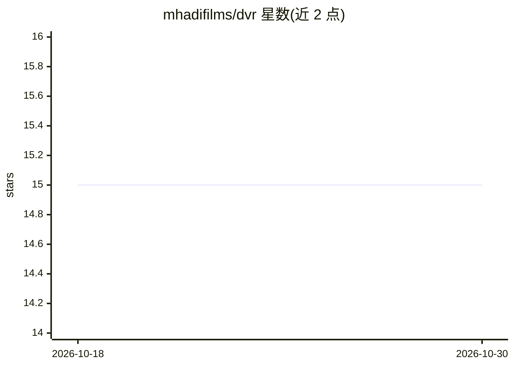

# mhadifilms/dvr

⭐ 15 · Python · MIT · 推送 2026-10-21 · [GitHub](https://github.com/mhadifilms/dvr) · [官网](https://mhadifilms.github.io/dvr) · 个人维护

**DaVinci Resolve 自动化工具：CLI、Python 库与 MCP 服务器**

面向 DaVinci Resolve 用户的自动化套件，提供命令行工具、类型化 Python 库和 MCP 服务器三种形式，覆盖剪辑、调色、渲染与交付自动化。将 Resolve 官方脚本 API 封装为幂等操作与结构化 JSON 输出，LLM 代理（Claude、Cursor 及任意 MCP 客户端）可直接调用 39+ 个类型化工具。支持声明式 YAML 规格的 dvr apply 与持久连接。限制：外部脚本需 Resolve Studio 18.5+（付费版），免费版仅可用 schema/inspect 与 --dry-run。

## 筛选速览

| 维度 | 判定 | 备注 |
|---|---|---|
| AI 角色 | `ai-ecosystem` | LLM/agent 周边工具 |
| 许可风险 | `permissive` | MIT |
| 部署形态 | `library` | 以包/库形式分发 |
| 模型依赖 | — | README 未给出锁定关系 |
| 硬件要求 | — | 无带数字的原话,不猜 |
| 安装摩擦 | `low` | 无编译、无系统依赖或容器化 |
| 成熟度 | — | 结构信号不足 |

## 能力要点

- CLI / Python 库 / MCP 服务器三种使用方式
- 39+ 类型化工具供 LLM 代理直接调用，输出结构化 JSON
- 幂等 ensure 操作与解码错误（cause/fix/state）
- 声明式 YAML 规格 dvr apply 与持久连接（<100ms 连续命令）

## 适用场景

- 剪辑师用脚本批量管理项目、时间线与渲染任务
- 让 Claude/Cursor 等 AI 代理直接操作 Resolve 完成剪辑与导出
- 用声明式规格声明并调和项目状态

## 场景标签

`工作流自动化` `图像视频处理` · 领域:效率与自动化

## 证据(README 行号)

> L15: `dvr` is a command-line tool, a typed Python library, and a Model Context Protocol (MCP) server for automating **Da
> L63: ### 3. MCP server (for LLM agents)
> L69: $ dvr mcp tools              # introspect the 39+ typed tools

## 星数曲线

2026-10-18 15 → 2026-10-30 15（+0）

---
*卡片 v1 · prompt 1.4 · 生成 2026-10-30 · 置信度 high · 依据 README sha `26606b3280b4` · [字段定义](../../DATASET.md)*
