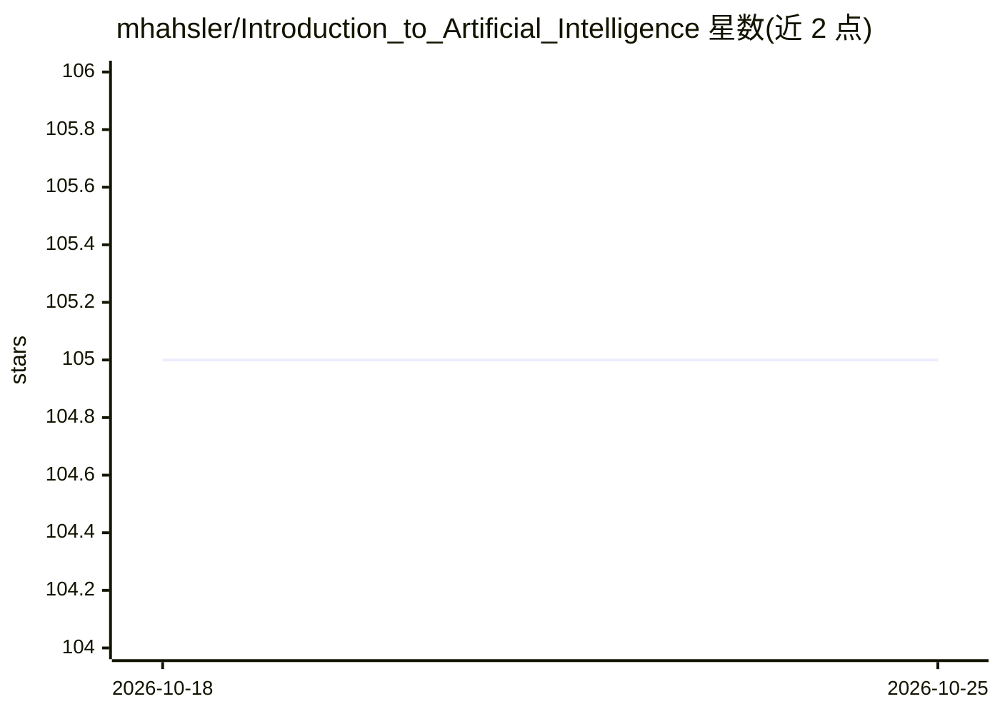

# mhahsler/Introduction_to_Artificial_Intelligence

⭐ 105 · Jupyter Notebook · CC-BY-SA-4.0 · 推送 2026-10-23 · [GitHub](https://github.com/mhahsler/Introduction_to_Artificial_Intelligence) · [官网](https://mhahsler.github.io/Introduction_to_Artificial_Intelligence/) · 组织维护

**AI 课程教学材料：AIMA 教材各章讲义与 Python 示例**

SMU 计算机 CS 5/7320 人工智能课程配套仓库，由 Michael Hahsler 维护，覆盖 Russell 与 Norvig《Artificial Intelligence: A Modern Approach》多章内容：提供 PDF/PowerPoint 讲义幻灯片与简洁 Python 代码示例及练习，涉及搜索、对抗博弈、约束满足、贝叶斯网络、机器学习、强化学习与 MDP 等。代码刻意保持简单以聚焦基础概念，更复杂示例指向 aimacode 仓库。附 HOWTO 指南与一个基于 GPT 的教材问答聊天机器人链接。

## 筛选速览

| 维度 | 判定 | 备注 |
|---|---|---|
| AI 角色 | `ai-knowledge` | 知识聚合/清单类 |
| 许可风险 | `viral` | CC-BY-SA-4.0 |
| 部署形态 | `None` |  |
| 模型依赖 | — | README 未给出锁定关系 |
| 硬件要求 | — | 无带数字的原话,不猜 |
| 安装摩擦 | `low` | 无编译、无系统依赖或容器化 |
| 成熟度 | — | 结构信号不足 |

## 能力要点

- 覆盖 AIMA 教材 13 个模块的讲义幻灯片与代码示例
- 代码刻意保持简单，聚焦基础 AI 概念而非工程实现
- 附 HOWTO 指南（Python/Jupyter 安装使用、作业流程）

## 适用场景

- 按 AIMA 教材章节学习 AI 基础概念并跑示例代码
- 教师选取现成讲义与练习组织 AI 课程
- 复习搜索、贝叶斯网络、机器学习等主题的入门实现

## 场景标签

`教程课程` · 领域:学习与行业

## 证据(README 行号)

> L4: This repository contains lecture material, simple Python code examples, and programming exercises for the course
> L10: The code examples cover several chapters of the textbook Artificial Intelligence: A Modern Approach (AIMA) by Russe

## 星数曲线

2026-10-18 105 → 2026-10-25 105（+0）

---
*卡片 v1 · prompt 1.4 · 生成 2026-10-23 · 置信度 high · 依据 README sha `af5197cf3e24` · [字段定义](../../DATASET.md)*
