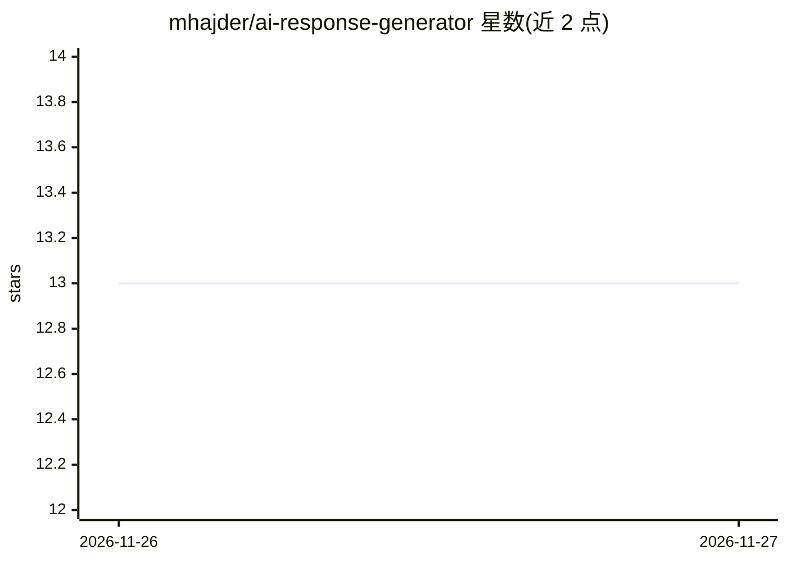

# mhajder/ai-response-generator

⭐ 13 · PHP · MIT · 推送 2026-11-25 · [GitHub](https://github.com/mhajder/ai-response-generator) · 个人维护

**osTicket 客服工单系统的 AI 回复生成插件**

面向 osTicket 1.17/1.18+（PHP 8.2–8.4）的工单 AI 助手插件，将回复起草、工单摘要、草稿润色/翻译、知识库 FAQ 匹配与自定义 RAG 上下文注入 Agent 面板。支持五种接入协议（OpenAI Chat/Responses、Anthropic、Ollama 原生、Azure OpenAI）与自动探测，回复以 SSE 流式预览；发送前可对邮箱、电话、信用卡号、IPv4 做 PII 脱敏；支持多实例按部门隔离。以 .phar 或解压目录方式安装。

## 筛选速览

| 维度 | 判定 | 备注 |
|---|---|---|
| AI 角色 | `ai-native` | 本体是模型或模型工具 |
| 许可风险 | `permissive` | MIT |
| 部署形态 | `desktop` | 安装包/桌面程序 |
| 模型依赖 | local-ok | 支持本地模型 |
| 硬件要求 | — | 无带数字的原话,不猜 |
| 安装摩擦 | `low` | 无编译、无系统依赖或容器化 |
| 成熟度 | — | 结构信号不足 |

## 能力要点

- 五种 provider 协议接入：OpenAI、Anthropic、Ollama、Azure OpenAI 与 OpenAI 兼容 API
- 回复起草/摘要/改写/翻译，SSE 流式预览与一键预设指令
- 发送前 PII 脱敏（邮箱/电话/Luhn 信用卡/IPv4），内部备注默认排除
- 多实例配置并可按部门 ID 限制使用范围

## 适用场景

- 客服人员在工单面板内一键生成客户回复草稿
- 把工单线程摘要直接插入内部备注
- 接入本地 Ollama 模型避免工单数据外发
- 为不同部门配置不同模型与提示词的实例

## 场景标签

`AI 写作` · 领域:内容生成

## 证据(README 行号)

> L17: An AI assistant plugin for **osTicket 1.17 / 1.18+ (PHP 8.2–8.4)** that brings reply drafting, ticket summarization
> L48: |**Ollama Native**|`ollama`|`.../api/chat`|Streaming NDJSON (`stream: true`) & non-streaming chat with `options.tem

## 星数曲线

2026-11-26 13 → 2026-11-27 13（+0）

---
*卡片 v1 · prompt 1.4 · 生成 2026-11-26 · 置信度 high · 依据 README sha `b868d8ce3e86` · [字段定义](../../DATASET.md)*
