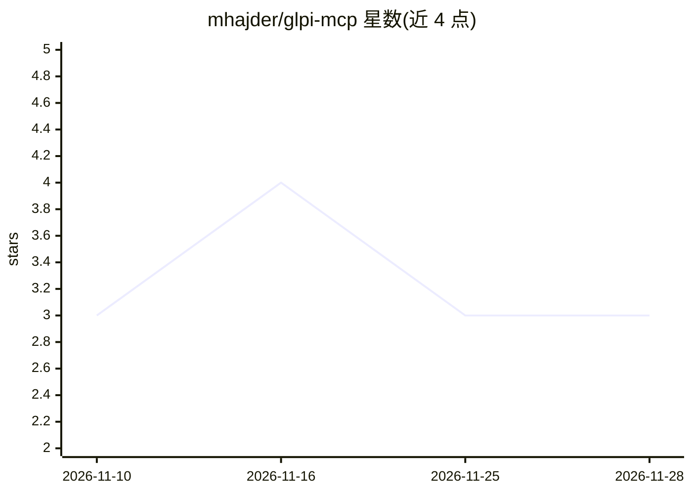

# mhajder/glpi-mcp

⭐ 3 · Python · MIT · 推送 2026-11-27 · [GitHub](https://github.com/mhajder/glpi-mcp) · [官网](https://pypi.org/project/glpi-mcp-server/) · 个人维护

**让 AI agent 通过 MCP 操作 GLPI 工单、资产与知识库的服务器**

基于 Python 的 Model Context Protocol (MCP) 服务器，对接 GLPI IT 服务管理平台的 High-Level API（/api.php，OAuth2）。提供 60 余个工具：按 RSQL 过滤检索工单/变更/问题及其时间线、资产管理、用户/组/实体、知识库文章、文档下载，以及覆盖全部 API 端点的通用读写工具。支持 STDIO/SSE/HTTP 传输、只读与 dry-run 模式、按用户访问（token 透传或 GLPI OAuth 登录）、OIDC 与静态 bearer token。要求 GLPI 11.0.6+ 或 12.x，文档上传需经 GLPI 本体完成。

## 筛选速览

| 维度 | 判定 | 备注 |
|---|---|---|
| AI 角色 | `ai-ecosystem` | LLM/agent 周边工具 |
| 许可风险 | `permissive` | MIT |
| 部署形态 | `self-host` | docker 或自建部署 |
| 模型依赖 | — | README 未给出锁定关系 |
| 硬件要求 | — | 无带数字的原话,不猜 |
| 安装摩擦 | `low` | 无编译、无系统依赖或容器化 |
| 成熟度 | — | 结构信号不足 |

## 能力要点

- 覆盖工单、变更、问题、资产、知识库、文档的读写工具集，另有通用端点工具
- 基于 GLPI OpenAPI 文档动态发现端点，不硬编码单一版本
- 只读、dry-run 模式与按标签工具过滤；限流与响应大小限制
- 多认证模式：静态 token、OIDC、GLPI OAuth 登录、token 透传

## 适用场景

- 让 Claude/Open WebUI 等 MCP 客户端查询和处理 ITSM 工单
- 通过 AI 助手检索公司资产与配置项（CMDB）信息
- 以只读模式安全地把服务台数据暴露给自动化流程

## 场景标签

 · 领域:IT 服务管理/AI 工具集成

## 证据(README 行号)

> L15: GLPI MCP Server is a Python-based Model Context Protocol (MCP) server for the GLPI IT service management platform. 
> L3: **Let AI agents work with GLPI tickets, assets and the knowledge base through the Model Context Protocol**

## 星数曲线

2026-11-10 3 → 2026-11-28 3（+0）

---
*卡片 v1 · prompt 1.4 · 生成 2026-11-21 · 置信度 high · 依据 README sha `242acfc94520` · [字段定义](../../DATASET.md)*
