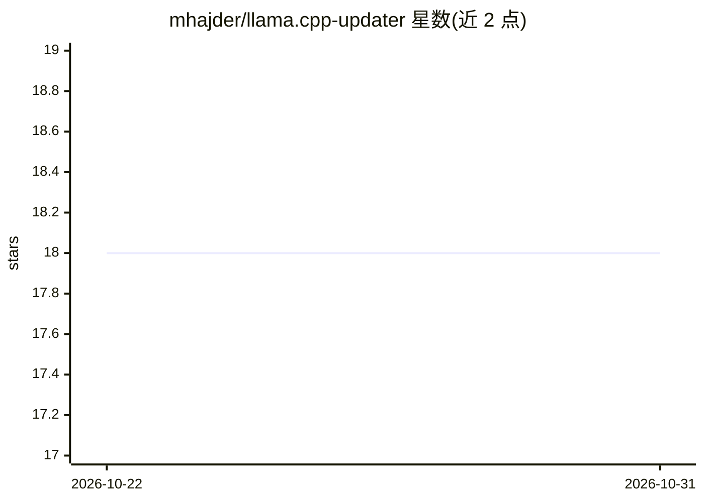

# mhajder/llama.cpp-updater

⭐ 18 · Shell · MIT · 推送 2026-10-20 · [GitHub](https://github.com/mhajder/llama.cpp-updater) · 个人维护

**一条命令更新 llama.cpp 的 Bash 脚本：下载 nightly 二进制或源码编译**

面向 llama.cpp 用户的 Bash 更新/安装脚本：从 GitHub 最新 b[NUM] nightly 发布下载 Linux/macOS（x64/ARM64）预编译二进制并校验 sha256，或以 --build-from-source 从源码编译并自动检测 CUDA/Vulkan/OpenCL/Metal 加速。更新采用暂存后原子替换，失败可回滚；通过 manifest 清理不再发布的旧文件，不触碰目标目录中其他内容。二进制路径仅需 curl/wget、tar 等少量依赖，源码路径需 git、cmake≥3.14、C++17 编译器及约 2GB 磁盘空间，GPU 库为可选检测项。支持 GITHUB_TOKEN 提升 API 速率限制。

## 筛选速览

| 维度 | 判定 | 备注 |
|---|---|---|
| AI 角色 | `ai-ecosystem` | LLM/agent 周边工具 |
| 许可风险 | `permissive` | MIT |
| 部署形态 | `desktop` | 安装包/桌面程序 |
| 模型依赖 | — | README 未给出锁定关系 |
| 硬件要求 | — | 无带数字的原话,不猜 |
| 安装摩擦 | `high` | 编译与系统依赖俱全 |
| 成熟度 | — | 结构信号不足 |

## 能力要点

- 自动选取最新 b[NUM] nightly 并按 sha256 摘要校验下载
- 源码构建时自动检测 CUDA/Vulkan/OpenCL/Metal 加速
- 暂存-替换式安全更新，失败时恢复原安装；manifest 追踪并清理过期文件
- 跨 Linux(Ubuntu)/macOS 的 x64 与 ARM64 架构检测

## 适用场景

- 重复运行一条命令保持本地 llama.cpp 始终为最新 nightly
- 无手动配置即在 NVIDIA/AMD/Intel/Apple GPU 上获得加速构建
- 希望更新失败时自动回滚、不破坏目标目录中其他文件

## 场景标签

 · 领域:LLM 基础设施/工具

## 证据(README 行号)

> L17: A powerful shell script that automatically downloads and updates llama.cpp binaries from the latest nightly GitHub 
> L19: Since v0.2.0 llama.cpp publishes both stable `vX.Y.Z` tags and per-commit `b[NUM]` nightly tags. Only the nightlies

## 星数曲线

2026-10-22 18 → 2026-10-31 18（+0）

---
*卡片 v1 · prompt 1.4 · 生成 2026-10-29 · 置信度 high · 依据 README sha `8b5949104009` · [字段定义](../../DATASET.md)*
