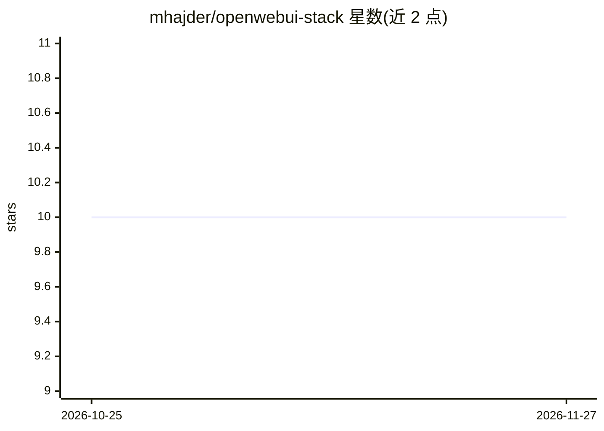

# mhajder/openwebui-stack

⭐ 10 · Shell · MIT · 推送 2026-06-19 · [GitHub](https://github.com/mhajder/openwebui-stack) · 个人维护

**自托管 LLM 网关的部署模板：为开发者提供 Open WebUI + LiteLLM 一键 Docker 编排**

一个 Docker Compose 编排模板，整合 Open WebUI（LLM 交互界面）、LiteLLM 统一网关、PostgreSQL 共享数据库、Qdrant 向量库与 LGTM 可观测栈（Grafana/Loki/Tempo/Mimir）、Traefik 反向代理及 OpenTelemetry 采集。提供 setup 脚本自动生成密钥与密码，含 7 套预配置 Grafana 面板与可选 GPU 监控 profile，并给出生产环境证书、安全加固与备份清单。面向需要自部署与监控 LLM 服务的开发者/运维。

## 筛选速览

| 维度 | 判定 | 备注 |
|---|---|---|
| AI 角色 | `ai-ecosystem` | LLM/agent 周边工具 |
| 许可风险 | `permissive` | MIT |
| 部署形态 | `self-host` | docker 或自建部署 |
| 模型依赖 | — | README 未给出锁定关系 |
| 硬件要求 | — | 无带数字的原话,不猜 |
| 安装摩擦 | `low` | 无编译、无系统依赖或容器化 |
| 成熟度 | — | 结构信号不足 |

## 能力要点

- LiteLLM 统一网关接入 OpenAI、Anthropic、Gemini、Ollama 等多个 provider
- LGTM 栈提供日志、追踪、指标全链路可观测
- setup 脚本自动生成强密码与 API key
- Qdrant 向量库支持 RAG 语义检索

## 适用场景

- 自托管 Open WebUI 并统一管理多个 LLM 提供商
- 监控 LLM 代理的请求数、token 用量与成本
- 搭建带向量库的 RAG 后端基础设施

## 场景标签

`模型网关` `LLM 可观测性` · 领域:Agent 开发

## 证据(README 行号)

> L17: - **LiteLLM Proxy**: Unified gateway for multiple LLM providers (OpenAI, Anthropic, Gemini, Ollama)
> L18: - **LGTM Observability Stack**: Grafana, Loki, Tempo, Mimir for logs, traces, and metrics
> L98: - **LiteLLM**: Unified gateway for multiple LLM providers

## 星数曲线

2026-10-25 10 → 2026-11-27 10（+0）

---
*卡片 v1 · prompt 1.4 · 生成 2026-11-19 · 置信度 high · 依据 README sha `cb6d7b11b64f` · [字段定义](../../DATASET.md)*
