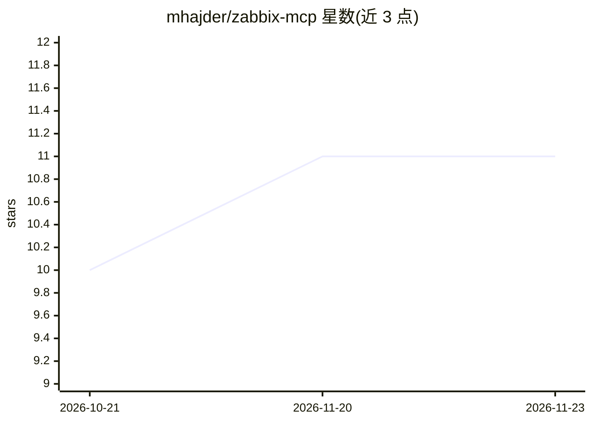

# mhajder/zabbix-mcp

⭐ 11 · Python · MIT · 推送 2026-11-19 · [GitHub](https://github.com/mhajder/zabbix-mcp) · [官网](https://pypi.org/project/zabbix-mcp/) · 个人维护

**让 AI agent 通过 MCP 查询和管理 Zabbix 监控的服务器**

基于 Python 的 Model Context Protocol 服务器，将 Zabbix 6.0–7.4 的 API 封装为约 60 个 MCP 工具，覆盖主机、模板、触发器、问题与事件、历史与趋势数据、维护周期、用户、代理、SLA、脚本执行及配置导入导出。支持只读模式、按标签禁用工具类别、滑动窗口限流、Bearer token 认证、SSL/TLS 与三种传输方式（STDIO/SSE/HTTP）。通过 uvx/pip 安装或 Docker 部署，需具备可访问的 Zabbix 服务器与 API 凭据。

## 筛选速览

| 维度 | 判定 | 备注 |
|---|---|---|
| AI 角色 | `ai-ecosystem` | LLM/agent 周边工具 |
| 许可风险 | `permissive` | MIT |
| 部署形态 | `self-host` | docker 或自建部署 |
| 模型依赖 | — | README 未给出锁定关系 |
| 硬件要求 | — | 无带数字的原话,不猜 |
| 安装摩擦 | `low` | 无编译、无系统依赖或容器化 |
| 成熟度 | — | 结构信号不足 |

## 能力要点

- 将 Zabbix API 暴露为约 60 个 MCP 工具，供 AI agent 调用
- 只读模式与基于标签的工具过滤保障安全监控
- 限流、Bearer 认证、SSL/TLS 与审计日志等安全机制
- 支持 STDIO、SSE、HTTP Streamable 三种传输方式

## 适用场景

- 让 AI 助手查询监控数据并应答当前问题与事件
- 通过自然语言代理执行主机/模板/维护周期管理操作
- 在只读模式下安全接入 AI 自动化与仪表盘工作流

## 场景标签

 · 领域:基础设施监控/MCP 工具集成

## 证据(README 行号)

> L3: **Let AI agents query and manage Zabbix monitoring through the Model Context Protocol**
> L15: Zabbix MCP Server is a Python-based Model Context Protocol (MCP) server designed to provide advanced, programmable 

## 星数曲线

2026-10-21 10 → 2026-11-23 11（+1）

---
*卡片 v1 · prompt 1.4 · 生成 2026-11-19 · 置信度 high · 依据 README sha `ed28f12971e2` · [字段定义](../../DATASET.md)*
