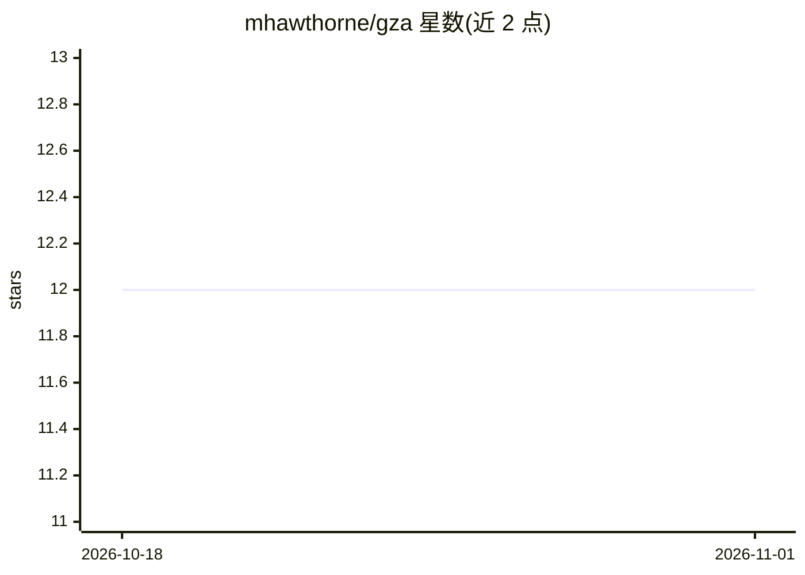

# mhawthorne/gza

⭐ 12 · Python · MIT · 推送 2026-10-19 · [GitHub](https://github.com/mhawthorne/gza) · 个人维护

**排队编码任务给后台 AI agent 执行与审查的个人软件工厂**

GZA 是一个命令行工具，将编码任务排入队列，由后台 LLM 编码代理（Claude Code 或 Codex CLI，至少需其一）并行完成计划、实现、审查与测试，通过审查的任务自动合并。任务可通过 CLI、/gza-task-add 技能或与 Claude/Codex 对话添加。提供手动 iterate 单任务循环与 watch 异步批量两种运行模式。依赖 uv 安装，Docker 可选用于任务隔离容器（作者注明非 Docker 路径较少使用、可能存在更多问题）。

## 筛选速览

| 维度 | 判定 | 备注 |
|---|---|---|
| AI 角色 | `ai-ecosystem` | LLM/agent 周边工具 |
| 许可风险 | `permissive` | MIT |
| 部署形态 | `None` |  |
| 模型依赖 | — | README 未给出锁定关系 |
| 硬件要求 | — | 无带数字的原话,不猜 |
| 安装摩擦 | `low` | 无编译、无系统依赖或容器化 |
| 成熟度 | `idea` | |

## 能力要点

- 任务队列由后台代理并行执行 plan/implement/review/test 并自动合并
- 支持 Claude Code 与 Codex 两种 LLM CLI 后端
- 两种模式：gza iterate 单任务循环与 gza watch 按 tag 异步批处理
- 任务可对话式添加（安装技能后与 Claude/Codex 直接对话）

## 适用场景

- 把编码任务排队交给后台代理并行处理
- 批量管理并自动审查合并代码任务
- 用 tag 按目标周期分组跟踪任务

## 场景标签

`编码 Agent` · 领域:编码与开发

## 证据(README 行号)

> L5: A personal software factory - queues coding tasks for background agents to plan, implement, review, and test in para
> L10: - A LLM provider CLI (at least one required):

## 星数曲线

2026-10-18 12 → 2026-11-01 12（+0）

---
*卡片 v1 · prompt 1.4 · 生成 2026-11-01 · 置信度 high · 依据 README sha `99e848f66bfe` · [字段定义](../../DATASET.md)*
