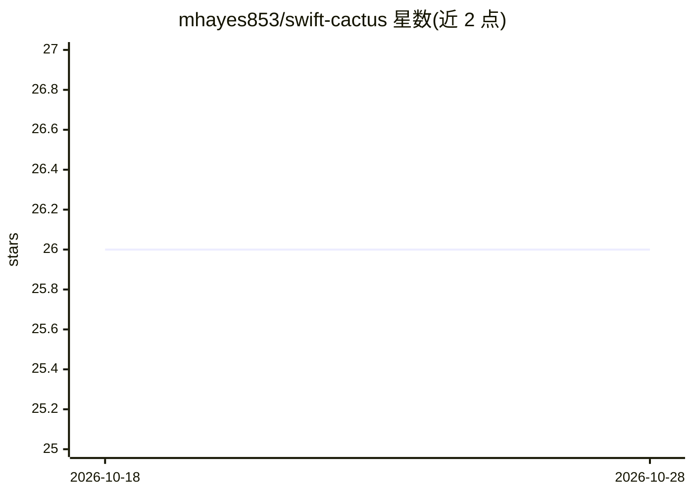

# mhayes853/swift-cactus

⭐ 26 · Swift · MIT · 推送 2026-04-18 · [GitHub](https://github.com/mhayes853/swift-cactus) · 个人维护

**跨平台 Swift SDK：在移动与穿戴应用内本地运行 LLM 推理**

Cactus 推理引擎的 Swift SDK，支持全部 Apple 平台、Android 与 Linux ARM。面向在应用内集成本地 AI 的开发者：通过 CactusAgentSession 进行对话，支持函数调用、视觉、语音转文字（Whisper/Parakeet 模型）、实时转录、语言检测、VAD、向量嵌入与索引。特定模型在 Apple 平台可经 ANE 启用 NPU 加速，通过 cactusCloudAPIKey 可在本地置信度不足时自动切换云端混合推理。安装方式为 Xcode 添加包或 SwiftPM 依赖，MIT 许可。语言检测目前仅限 Whisper 模型。

## 筛选速览

| 维度 | 判定 | 备注 |
|---|---|---|
| AI 角色 | `ai-ecosystem` | LLM/agent 周边工具 |
| 许可风险 | `permissive` | MIT |
| 部署形态 | `None` |  |
| 模型依赖 | — | README 未给出锁定关系 |
| 硬件要求 | — | 无带数字的原话,不猜 |
| 安装摩擦 | `low` | 无编译、无系统依赖或容器化 |
| 成熟度 | — | 结构信号不足 |

## 能力要点

- 对话、函数调用（@JSONSchema 宏自动生成 schema）、视觉与流式输出
- STT/实时转录/语言检测/VAD 语音能力
- 向量嵌入与低层向量索引（CactusIndex）
- 本地与云端混合推理自动切换，Apple 平台 NPU（ANE）加速

## 适用场景

- 在 iOS/Android 应用中嵌入本地 LLM 对话能力
- 为应用添加离线语音转文字与实时转录
- 本地模型置信度不足时自动回退云端混合推理

## 场景标签

`推理引擎` `语音识别` · 领域:感知与多模态

## 证据(README 行号)

> L7: Cactus is a low-latency inference engine for mobile devices and wearables, allowing you to run high-performance AI l
> L4: Cross-platform Swift SDK for Cactus inference.

## 星数曲线

2026-10-18 26 → 2026-10-28 26（+0）

---
*卡片 v1 · prompt 1.4 · 生成 2026-10-26 · 置信度 high · 依据 README sha `630ce6f340a2` · [字段定义](../../DATASET.md)*
