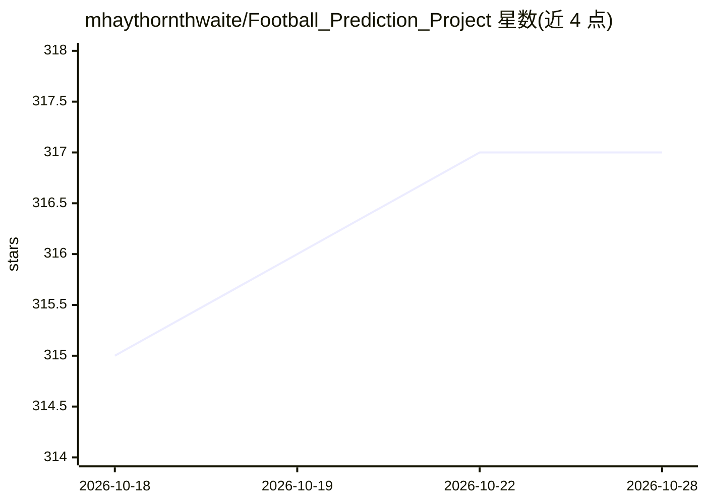

# mhaythornthwaite/Football_Prediction_Project

⭐ 317 · Python · MIT · 推送 2026-03-25 · [GitHub](https://github.com/mhaythornthwaite/Football_Prediction_Project) · [官网](http://matthaythornthwaite.pythonanywhere.com/) · 个人维护

**用经典机器学习预测英超比赛结果的分析项目**

个人研究型项目：通过 api-football API 采集 2019-2020 赛季以来的英超逐场统计数据（射门、控球率等），清洗整理为嵌套字典结构，构造近 10 场均值差值的 14 维特征，用 scikit-learn 训练决策树、SVM、KNN 等模型并经 5 折交叉验证与网格搜索调优。随机森林达到约 50.8% 测试准确率；README 记录平局预测效果差及模型概率可靠性分析。曾在网页应用中展示实时预测，但该功能已不再支持；无安装运行说明。

## 筛选速览

| 维度 | 判定 | 备注 |
|---|---|---|
| AI 角色 | `ai-native` | 本体是模型或模型工具 |
| 许可风险 | `permissive` | MIT |
| 部署形态 | `None` |  |
| 模型依赖 | — | README 未给出锁定关系 |
| 硬件要求 | — | 无带数字的原话,不猜 |
| 安装摩擦 | `low` | 无编译、无系统依赖或容器化 |
| 成熟度 | — | 结构信号不足 |

## 能力要点

- api-football API 采集数据并支持逐日更新再训练
- 近 10 场均值差值的 14 维特征工程与可视化分析
- scikit-learn 多算法对比 + 网格搜索 5 折交叉验证
- 模型概率可靠性评估（随机森林 50.8% 准确率）

## 适用场景

- 学习体育赛果预测的完整数据科学流程
- 参考比赛数据特征工程与模型评估方法
- 复用 API 数据采集与清洗脚本做类似分析

## 场景标签

`数据分析` · 领域:效率与自动化

## 证据(README 行号)

> L25: The aim of this study was to build a model that could accurately predict the outcome of future premier league footb
> L63: A range of algorithms were selected and tested from the library: scikit-learn. All models were optimised using a gr

## 星数曲线

2026-10-18 315 → 2026-10-28 317（+2）

---
*卡片 v1 · prompt 1.4 · 生成 2026-10-21 · 置信度 high · 依据 README sha `22541826be67` · [字段定义](../../DATASET.md)*
