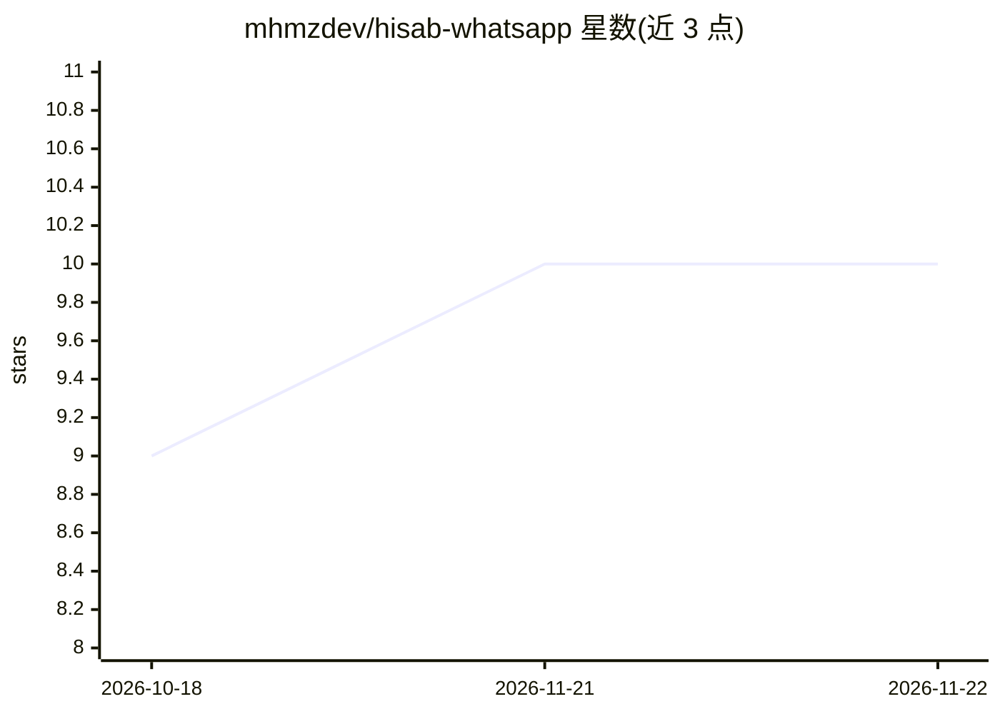

# mhmzdev/hisab-whatsapp

⭐ 10 · Python · MIT · 推送 2026-09-20 · [GitHub](https://github.com/mhmzdev/hisab-whatsapp) · [官网](https://mhmzdev.github.io/hisab/) · 个人维护

**通过 WhatsApp 记账：文字/语音/收据照片生成 hledger 账目**

面向个人与小店的语音/图片/文字记账应用：用户向自己的 WhatsApp agent 发送一行文字、语音便签、收据照片或转发的银行短信，模型经六工具调用循环将输入解析为复式记账条目写入本地 hledger 明细账，每笔可回复消息撤销，账本为可导出的 markdown 文件。运行依赖 Docker、hledger 与 OpenRouter/Gemini 密钥；支持英/乌尔都语会话式设置、自托管与本地终端演示路径。作者声明源自黑客松作品，托管版尚示部署。

## 筛选速览

| 维度 | 判定 | 备注 |
|---|---|---|
| AI 角色 | `ai-native` | 本体是模型或模型工具 |
| 许可风险 | `permissive` | MIT |
| 部署形态 | `self-host` | docker 或自建部署 |
| 模型依赖 | locked-api |  |
| 硬件要求 | — | 无带数字的原话,不猜 |
| 安装摩擦 | `low` | 无编译、无系统依赖或容器化 |
| 成熟度 | `idea` | |

## 能力要点

- 文字、语音（乌尔都语/罗马乌尔都语/英语）、收据照片、转发银行短信均可入账
- 六工具调用循环写入 hledger，每笔追加执行 hledger check --strict 校验
- 回复引用旧消息即撤销条目，消息 id 幂等防重放
- 会话式多语言设置与 /lang 切换；export-ledger 以 ZIP 返还账本

## 适用场景

- 个人用 WhatsApp 随手记日常收支
- 小店店主用语音和收据照片记销售与供应商欠款
- 转发银行短信自动生成借/贷条目
- 导出 markdown 账本后在 Obsidian 等工具查看报表

## 场景标签

`AI 助手` · 领域:对话与助手

## 证据(README 行号)

> L5: A ledger you text. Send **"2500 coffee"**, a voice note in Urdu, Roman Urdu or English, or a photo of a receipt to y
> L62: - **A small tool-calling loop** on any OpenAI-compatible endpoint (OpenRouter by default, one key for the model and

## 星数曲线

2026-10-18 9 → 2026-11-22 10（+1）

---
*卡片 v1 · prompt 1.4 · 生成 2026-11-21 · 置信度 high · 依据 README sha `d21bae9a9faf` · [字段定义](../../DATASET.md)*
