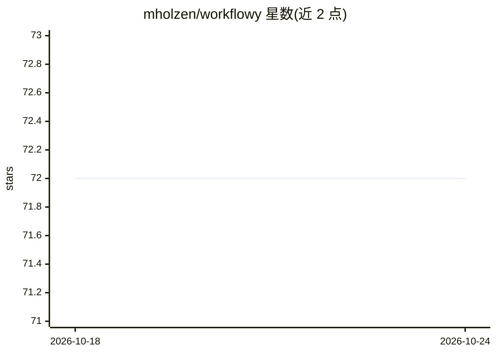

# mholzen/workflowy

⭐ 72 · Go · MIT · 推送 2026-08-14 · [GitHub](https://github.com/mholzen/workflowy) · [官网](https://workflowy.com) · 个人维护

**WorkFlowy 的 MCP 服务器与 CLI：让 AI 助手和终端操作大纲数据**

用 Go 编写的 WorkFlowy 工具，同一二进制提供 CLI 与 MCP 服务器两种形态：AI 助手（如 Claude）通过 MCP 工具读取与修改 WorkFlowy 大纲，终端或脚本可执行全文/正则搜索、批量替换、CRUD、内容变换与使用报告。支持三种数据访问方式（get/export/backup），其中 Dropbox 备份方式可离线操作。写入范围可通过 --write-root-id 限制在指定子树，也可配置为只读模式。提供 Homebrew/Scoop/Go install/Docker/源码等安装途径。

## 筛选速览

| 维度 | 判定 | 备注 |
|---|---|---|
| AI 角色 | `ai-ecosystem` | LLM/agent 周边工具 |
| 许可风险 | `permissive` | MIT |
| 部署形态 | `self-host` | docker 或自建部署 |
| 模型依赖 | — | README 未给出锁定关系 |
| 硬件要求 | — | 无带数字的原话,不猜 |
| 安装摩擦 | `low` | 无编译、无系统依赖或容器化 |
| 成熟度 | — | 结构信号不足 |

## 能力要点

- CLI 与 MCP 服务器合一，提供读/写两类 MCP 工具
- 全文与正则搜索、批量查找替换、内容变换
- 使用报告：陈旧节点、节点数量、镜像节点分析
- 三种数据访问方式，Dropbox 备份支持离线模式

## 适用场景

- 让 Claude 等 AI 助手直接读写我的 WorkFlowy 大纲
- 在终端批量搜索替换 WorkFlowy 内容
- 生成报告找出长期未动的陈旧节点

## 场景标签

`知识库管理` · 领域:知识与检索

## 证据(README 行号)

> L3: A feature-rich **Model Context Protocol (MCP) server** and **Command Line Interface (CLI)** for Workflowy written in
> L59: claude mcp add --transport=stdio workflowy -- workflowy mcp --expose=all

## 星数曲线

2026-10-18 72 → 2026-10-24 72（+0）

---
*卡片 v1 · prompt 1.4 · 生成 2026-10-24 · 置信度 high · 依据 README sha `e6e01c0bbb72` · [字段定义](../../DATASET.md)*
