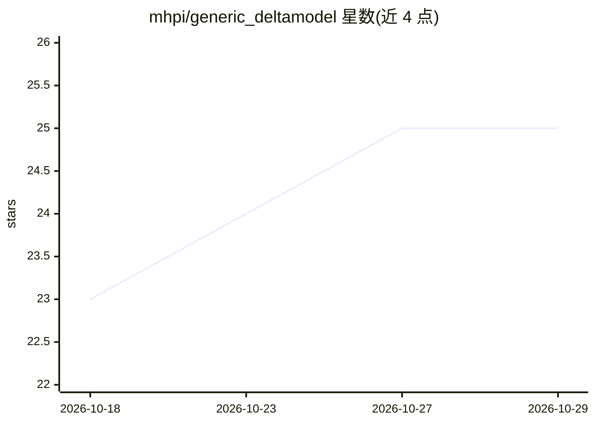

# mhpi/generic_deltamodel

⭐ 25 · Python · NOASSERTION · 推送 2026-10-07 · [GitHub](https://github.com/mhpi/generic_deltamodel) · [官网](https://mhpi.github.io/codes/frameworks/) · 组织维护

**构建可微分水文/地学模型的 PyTorch 框架**

δMG 是 MHPI 维护的通用可微分建模框架，基于 PyTorch 自动微分，将神经网络与基于过程的物理方程耦合：神经网络从数据生成物理模型参数，物理模型产出预测，支持 GPU 加速优化。模块化设计可替换模型、损失函数与数据加载器；符合 CSDMS BMI 规范以对接 NOAA-OWP NextGen 框架。提供 CAMELS 数据集快速上手与 Colab 教程，NN 训练依赖 NVIDIA GPU（CUDA），无 GPU 时可用 Colab 的 T4。

## 筛选速览

| 维度 | 判定 | 备注 |
|---|---|---|
| AI 角色 | `ai-ecosystem` | LLM/agent 周边工具 |
| 许可风险 | `none` | NOASSERTION |
| 部署形态 | `library` | 以包/库形式分发 |
| 模型依赖 | — | README 未给出锁定关系 |
| 硬件要求 | — | 无带数字的原话,不猜 |
| 安装摩擦 | `medium` | 含编译或系统依赖之一 |
| 成熟度 | `idea` | |

## 能力要点

- NN 与过程方程耦合的可微分混合建模（NN 生成物理参数）
- 模块化架构：可替换模型、损失函数、数据加载器
- CSDMS BMI 兼容，对接 NOAA-OWP NextGen 框架与 NGIAB
- 支持集总式与全国/全球尺度分布式水文建模（δHBV 系列）

## 适用场景

- 用水文数据训练可微分降雨-径流模型（如 δHBV）
- 构建全国或全球尺度的分布式水文模拟
- 做极端事件外推能力测试与基准复现

## 场景标签

`模型训练` · 领域:训练与推理

## 证据(README 行号)

> L14: 𝛿MG is a generic framework for building differentiable models that seamlessly couple neural networks with process-b
> L68: parameters = self.nn_model(dataset_sample['xc_nn_norm'])
> L69: predictions = self.phy_model(dataset_sample, parameters)

## 星数曲线

2026-10-18 23 → 2026-10-29 25（+2）

---
*卡片 v1 · prompt 1.4 · 生成 2026-10-27 · 置信度 high · 依据 README sha `708da2cc348f` · [字段定义](../../DATASET.md)*
