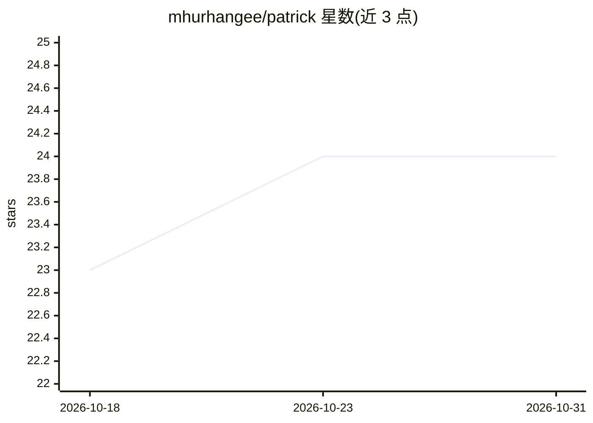

# mhurhangee/patrick

⭐ 24 · TypeScript · Apache-2.0 · 推送 2026-07-13 · [GitHub](https://github.com/mhurhangee/patrick) · [官网](https://usepatrick.com) · 个人维护

**本地运行的专利申请文件起草与红线修订桌面 AI 助手**

Windows 桌面应用，AI agent 在用户自己的 .docx 文件中以 Word 原生修订（tracked changes）形式起草与标注专利文件（OA 答复、权利要求修改），用户逐条接受或拒绝。支持钉入 PDF/Word 作为对话上下文（扫描件走设备端 OCR），引用 EPC/EPO 指南等法条原文，从 Google Patents 与 EPO OPS 拉取专利全文，生成权利要求对照表。模型为 BYOK：Anthropic/OpenAI/Google/Vercel AI Gateway，数据不离开本机。当前 alpha、仅 Windows、未签名、无自动更新。

## 筛选速览

| 维度 | 判定 | 备注 |
|---|---|---|
| AI 角色 | `ai-native` | 本体是模型或模型工具 |
| 许可风险 | `permissive` | Apache-2.0 |
| 部署形态 | `desktop` | 安装包/桌面程序 |
| 模型依赖 | — | README 未给出锁定关系 |
| 硬件要求 | — | 无带数字的原话,不猜 |
| 安装摩擦 | `low` | 无编译、无系统依赖或容器化 |
| 成熟度 | `idea` | |

## 能力要点

- 以 Word 原生 tracked changes 提出修订，用户接受/拒绝
- BYOK 接入 Anthropic/OpenAI/Google/Vercel AI Gateway，本地运行无自有服务器
- 引用 EPC/EPO 指南与上诉判例法原文作为依据
- 从 Google Patents/EPO OPS 获取专利全文并生成 claim charts

## 适用场景

- 在本地起草审查意见答复与权利要求修改
- 对照 EPO 法条与在先技术做专利分析
- 需要数据留在本机的涉密客户专利工作

## 场景标签

`AI 助手` `AI 写作` · 领域:对话与助手

## 证据(README 行号)

> L21: An open-source desktop app where an AI agent drafts and redlines patent documents
> L47: - **Your model.** Bring your own key — Anthropic, OpenAI, Google, or via the Vercel

## 星数曲线

2026-10-18 23 → 2026-10-31 24（+1）

---
*卡片 v1 · prompt 1.4 · 生成 2026-10-27 · 置信度 mid · 依据 README sha `2e1cb58be188` · [字段定义](../../DATASET.md)*
