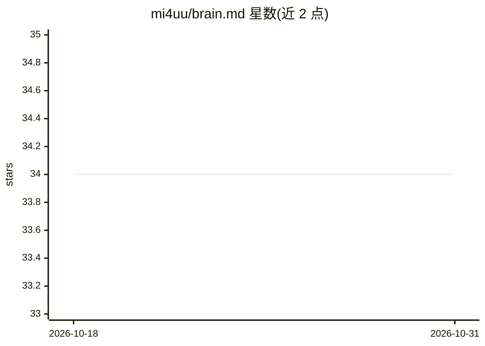

# mi4uu/brain.md

⭐ 34 · TypeScript · AGPL-3.0 · 推送 2026-08-16 · [GitHub](https://github.com/mi4uu/brain.md) · [官网](https://brainmd.lipinski.work) · 个人维护

**本地优先 Markdown 笔记库，内置 MCP 服务器供 AI 代理读写**

单文件 Bun 二进制形式的本地 Markdown 笔记应用：CodeMirror 6 编辑器 + 实时预览，兼容 Obsidian 风格语法（wikilinks、callouts、mermaid、frontmatter 等），每次保存自动 git 提交并提供版本历史。AI 相关：内置每库嵌入式向量存储（纯 JS 余弦检索），默认本地 WASM ONNX 运行 bge-small-en-v1.5 嵌入模型，可切换 Ollama/LM Studio/OpenAI 等任意 /v1/embeddings 端点；同端口挂载 streamable HTTP MCP 服务器（17 工具 + 2 资源），供 Claude Desktop、Claude Code、Cursor 等 MCP 客户端按文件夹级读写权限访问笔记。面向希望让 AI 代理安全接入个人笔记库的开发者与知识工作者。

## 筛选速览

| 维度 | 判定 | 备注 |
|---|---|---|
| AI 角色 | `ai-ecosystem` | LLM/agent 周边工具 |
| 许可风险 | `viral` | AGPL-3.0 |
| 部署形态 | `desktop` | 安装包/桌面程序 |
| 模型依赖 | local-ok | 支持本地模型 |
| 硬件要求 | — | 无带数字的原话,不猜 |
| 安装摩擦 | `low` | 无编译、无系统依赖或容器化 |
| 成熟度 | — | 结构信号不足 |

## 能力要点

- streamable HTTP MCP 服务器：17 工具 + 2 资源，文件夹级读写权限控制
- 内置每库向量存储，默认本地 WASM ONNX 运行 bge-small-en-v1.5，零 API key 离线可用
- 单文件二进制（bun --compile），vault 为磁盘上普通 .md 文件夹，无专有格式
- 每次保存自动 git 提交，笔记历史、diff 与一键恢复

## 适用场景

- 把个人笔记库变成 AI 代理可读写的记忆层
- 完全离线的 Markdown 笔记编辑与语义搜索
- 通过手机经 LAN/Tailscale/Cloudflare Tunnel 访问自托管笔记

## 场景标签

`知识库管理` `语义搜索` · 领域:知识与检索

## 证据(README 行号)

> L24: |🛰️ &nbsp; **MCP server (streamable HTTP)**|17 tools + 2 resources mounted on the same port. Claude Desktop, Claude
> L73: designed from day one as a memory layer for AI agents over the
> L311: ### 🔍 Semantic search (RAG)

## 星数曲线

2026-10-18 34 → 2026-10-31 34（+0）

---
*卡片 v1 · prompt 1.4 · 生成 2026-10-25 · 置信度 high · 依据 README sha `ace3a859b6f6` · [字段定义](../../DATASET.md)*
