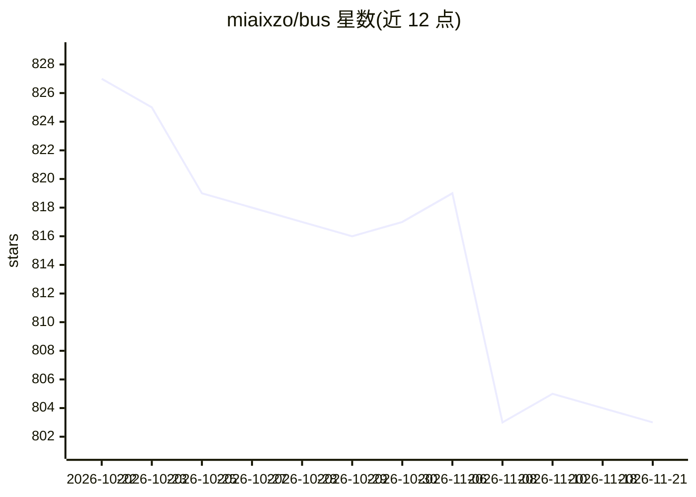

# miaixzo/bus

⭐ 803 · Java · Apache-2.0 · 推送 2026-11-20 · [GitHub](https://github.com/miaixzo/bus) · [官网](https://miaixz.org) · 个人维护 · 中文 README

**给 Java 开发者的轻量级企业应用/服务框架与中间件套件**

基于 Java 17+ 的企业级应用/服务框架，以 Maven/Gradle 依赖形式提供 30 余个模块，覆盖认证、缓存、限流、日志、支付聚合、对象存储、分布式任务调度、MyBatis 增强与响应式网关等。其中 AI 相关能力包括 bus-cortex（API/MCP/Prompt 统一注册与配置中心）与 bus-metrics 的 LLM 可观测性支持，另有封装 OpenCV 的图像模块。提供 3.x/5.x/6.x/8.x 多版本按 JDK 选择，bus-tracer 尚在开发中。

## 筛选速览

| 维度 | 判定 | 备注 |
|---|---|---|
| AI 角色 | `ai-enhanced` | 去掉 AI 部分产品仍成立 |
| 许可风险 | `permissive` | Apache-2.0 |
| 部署形态 | `None` |  |
| 模型依赖 | — | README 未给出锁定关系 |
| 硬件要求 | — | 无带数字的原话,不猜 |
| 安装摩擦 | `medium` | 含编译或系统依赖之一 |
| 成熟度 | — | 结构信号不足 |

## 能力要点

- 30+ 模块化组件：认证/缓存/限流/支付/存储/任务调度等
- bus-cortex 提供 API/MCP/Prompt 统一注册与健康探测
- bus-metrics 支持 LLM 可观测性与 SLO 跟踪
- 多 JDK 版本线（Java 8/17/21）按需选择

## 适用场景

- Java 微服务项目按需引入中间件能力，减少重复代码
- 统一管理 API/MCP/Prompt 注册与配置
- 接入支付、对象存储、通知等多渠道服务

## 场景标签

 · 领域:企业级 Java 中间件/微服务框架

## 证据(README 行号)

> L24: Bus (Enterprise Application/Service Bus) is a foundational framework and service suite; a lightweight enterprise-le
> L54: |[√]|bus-cortex|Unified registry and configuration center for API/MCP/Prompt entries, with health probing and space
> L64: |[√]|bus-metrics|Production-grade metrics framework, supporting cardinality guard/EWMA rates/SLO tracking/LLM obser

## 星数曲线

2026-10-22 827 → 2026-11-21 803（-24）

---
*卡片 v1 · prompt 1.4 · 生成 2026-11-17 · 置信度 mid · 依据 README sha `e90a56d8813e` · [字段定义](../../DATASET.md)*
