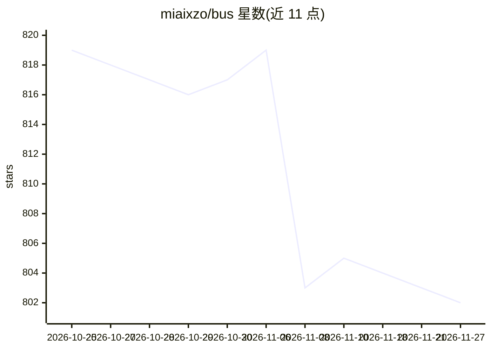

# miaixzo/bus

⭐ 802 · Java · Apache-2.0 · 推送 2026-11-26 · [GitHub](https://github.com/miaixzo/bus) · [官网](https://miaixz.org) · 个人维护 · 中文 README

**Java 企业级应用/服务总线框架，提供全套业务组件与中间件**

基于 Java 17+（8.x 编译于 Java 21）的企业级应用/服务框架与组件套件，覆盖统一认证（OIDC/OAuth2/SAML）、分布式缓存、加密、限流、任务调度、API 网关、对象存储、支付聚合、OCR 图像处理、OpenCV 封装等 30+ 模块；其中 bus-cortex 提供 API/MCP/Prompt 的注册与配置中心，bus-metrics 含 LLM 可观测性。通过 Maven/Gradle 依赖或 Maven Central 下载 JAR 使用，支持 GraalVM 相关元数据配置。

## 筛选速览

| 维度 | 判定 | 备注 |
|---|---|---|
| AI 角色 | `ai-enhanced` | 去掉 AI 部分产品仍成立 |
| 许可风险 | `permissive` | Apache-2.0 |
| 部署形态 | `None` |  |
| 模型依赖 | — | README 未给出锁定关系 |
| 硬件要求 | — | 无带数字的原话,不猜 |
| 安装摩擦 | `medium` | 含编译或系统依赖之一 |
| 成熟度 | — | 结构信号不足 |

## 能力要点

- 30+ 模块：认证、缓存、限流、网关、支付、调度、存储等标准化套件
- bus-cortex 统一注册 API/MCP/Prompt 条目，含健康探测与空间隔离
- bus-opencv 封装 OpenCV 提供图像识别/人脸检测/视频分析
- bus-auth 集成 15+ 第三方登录平台，支持 OIDC/OAuth2/SAML

## 适用场景

- 快速搭建分布式微服务架构的企业业务系统
- 统一管理 API/MCP/Prompt 入口的注册与配置
- Java 项目中集成支付、缓存、限流、对象存储等通用能力

## 场景标签

 · 领域:企业应用开发/Java 基础框架

## 证据(README 行号)

> L24: Bus (Enterprise Application/Service Bus) is a foundational framework and service suite; a lightweight enterprise-le
> L54: |[√]|bus-cortex|Unified registry and configuration center for API/MCP/Prompt entries, with health probing and space
> L68: |[√]|bus-opencv|Computer vision library, wrapping OpenCV to provide image recognition/face detection/video analysis

## 星数曲线

2026-10-25 819 → 2026-11-27 802（-17）

---
*卡片 v1 · prompt 1.4 · 生成 2026-11-25 · 置信度 mid · 依据 README sha `7505907104dc` · [字段定义](../../DATASET.md)*
