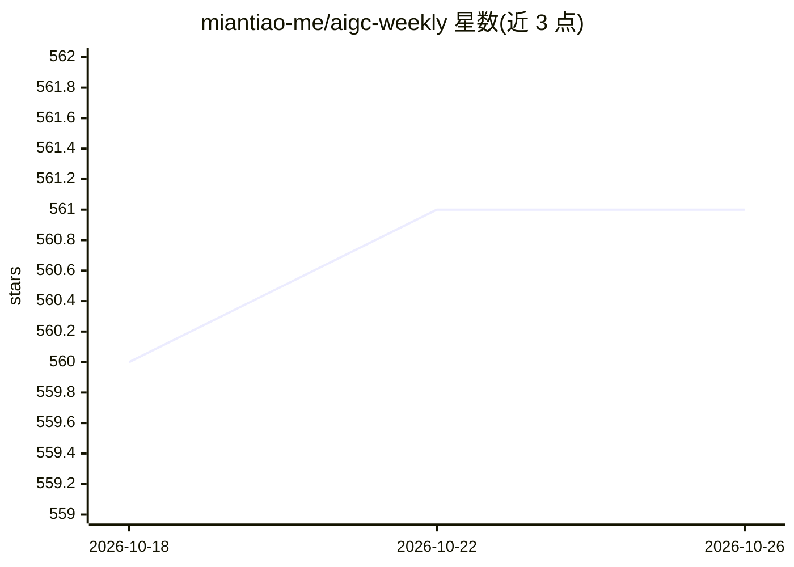

# miantiao-me/aigc-weekly

⭐ 561 · TypeScript · AGPL-3.0 · 推送 2026-10-18 · [GitHub](https://github.com/miantiao-me/aigc-weekly) · [官网](https://aigc-weekly.agi.li) · 个人维护 · 中文 README

**由 AI Agent 自动策展的 AIGC 周刊网站**

一个由 Agentic AI Agent 驱动的 AIGC 资讯周刊项目：运行在 Cloudflare Containers 上的 OpenCode Agent 通过 Firecrawl 爬取网页、筛选内容，并经 MCP 协议直接写入 Payload CMS；前端为 Next.js 应用，数据库用 D1，对象存储用 R2，由 Cloudflare Worker 转发请求并控制容器生命周期。读者可在线阅读或通过 RSS 订阅。自部署需 Node.js v22+、pnpm v10+ 与 Cloudflare 账号，本地运行 Agent 容器还需 Docker，Agent 容器云端运行需 Cloudflare 付费套餐。采用 AGPLv3 许可证。

## 筛选速览

| 维度 | 判定 | 备注 |
|---|---|---|
| AI 角色 | `ai-knowledge` | 知识聚合/清单类 |
| 许可风险 | `viral` | AGPL-3.0 |
| 部署形态 | `library` | 以包/库形式分发 |
| 模型依赖 | — | README 未给出锁定关系 |
| 硬件要求 | — | 无带数字的原话,不猜 |
| 安装摩擦 | `low` | 无编译、无系统依赖或容器化 |
| 成熟度 | — | 结构信号不足 |

## 能力要点

- OpenCode Agent 经 MCP 直接更新 Payload CMS 内容
- 全 Serverless 架构：Cloudflare Workers/D1/R2/Containers
- Firecrawl 执行网页爬取与信息提取
- 提供在线阅读与 RSS 订阅

## 适用场景

- 订阅 AI 自动筛选的 AIGC 资讯周刊
- 自部署一套 Agent 驱动的内容策展发布站
- 参考 MCP + Agent + Headless CMS 的内容生产架构

## 场景标签

`精选清单` · 领域:学习与行业

## 证据(README 行号)

> L3: 一个由 Agentic AI Agent 驱动的 AIGC（人工智能生成内容）精选周刊。本项目利用最新的 AI 和 Serverless 技术，为您提供最新的资讯、工具和资源。
> L13: - **AI 智能策展**：利用 Agentic AI Agent 自动发现和筛选内容。
> L33: 2. **OpenCode Agent (`agent/`)**：一个独立的 Agent 服务，运行在 **Cloudflare Containers** 上，负责收集信息并通过 MCP 更新 CMS。

## 星数曲线

2026-10-18 560 → 2026-10-26 561（+1）

---
*卡片 v1 · prompt 1.4 · 生成 2026-10-21 · 置信度 mid · 依据 README sha `b05b50066fc4` · [字段定义](../../DATASET.md)*
