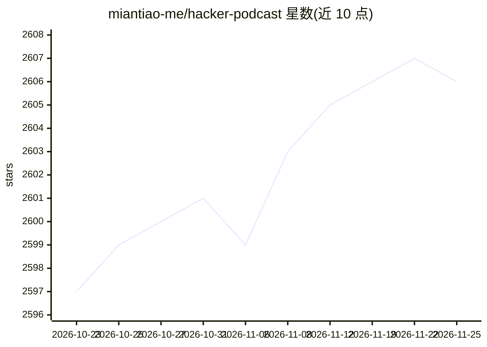

# miantiao-me/hacker-podcast

⭐ 2,606 · TypeScript · AGPL-3.0 · 推送 2026-10-21 · [GitHub](https://github.com/miantiao-me/hacker-podcast) · [官网](https://hacker-podcast.agi.li) · 个人维护 · 中文 README

**每天将 Hacker News 热文转成 AI 中文播客的项目**

该项目的 Worker 定时抓取 Hacker News 每日热门文章，调用 OpenAI API 生成中文摘要与播报文稿，再经 TTS 合成音频，结果存入 Cloudflare R2 和 KV，并通过 RSS feed 与网页对外提供，支持在播客 App 订阅收听。部署目标是 Cloudflare Workers，本地开发需 pnpm 安装依赖并配置环境变量；合并音频依赖 Cloudflare 浏览器端呈现，不支持纯本地运行，需远程调试。项目声明与 Hacker News 及 Y Combinator 无关联。

## 筛选速览

| 维度 | 判定 | 备注 |
|---|---|---|
| AI 角色 | `ai-native` | 本体是模型或模型工具 |
| 许可风险 | `viral` | AGPL-3.0 |
| 部署形态 | `library` | 以包/库形式分发 |
| 模型依赖 | — | README 未给出锁定关系 |
| 硬件要求 | — | 无带数字的原话,不猜 |
| 安装摩擦 | `low` | 无编译、无系统依赖或容器化 |
| 成熟度 | — | 结构信号不足 |

## 能力要点

- 每日自动抓取 Hacker News 热门文章并生成中文总结
- 通过 TTS 生成中文播报音频
- 存储到 Cloudflare R2 与 KV，经 RSS feed 分发
- 支持网页和播客 App 收听

## 适用场景

- 通勤时用播客 App 收听每日 Hacker News 中文摘要
- 自部署一个 HN 内容的中文播客站
- 作为 Cloudflare Workers 全栈项目的参考实现

## 场景标签

`语音合成` · 领域:内容生成

## 证据(README 行号)

> L3: 一个基于 AI 的 Hacker News 中文播客项目，每天自动抓取 Hacker News 热门文章，通过 AI 生成中文总结并转换为播客内容。
> L16: - 🎯 使用 AI 智能总结文章内容和评论
> L34: 2. 使用 AI 生成中文摘要和播报文稿

## 星数曲线

2026-10-23 2,597 → 2026-11-25 2,606（+9）

---
*卡片 v1 · prompt 1.4 · 生成 2026-11-23 · 置信度 mid · 依据 README sha `cc4eb3373981` · [字段定义](../../DATASET.md)*
