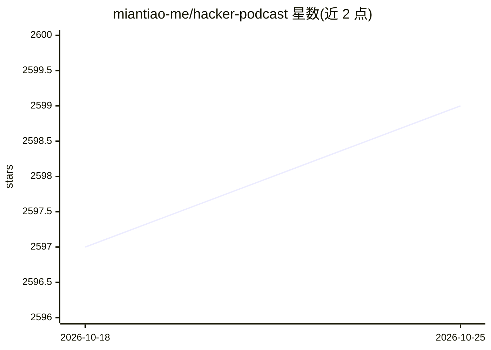

# miantiao-me/hacker-podcast

⭐ 2,599 · TypeScript · AGPL-3.0 · 推送 2026-10-21 · [GitHub](https://github.com/miantiao-me/hacker-podcast) · [官网](https://hacker-podcast.agi.li) · 个人维护 · 中文 README

**AI 自动生成的 Hacker News 中文播客站，每日更新**

自动化内容流水线项目：定时抓取 Hacker News 每日热门文章，用 OpenAI API 生成中文摘要与播报文稿，经 TTS 转为音频，存储于 Cloudflare R2/KV，通过 RSS、网页及 Apple Podcasts、小宇宙、Spotify 等渠道分发。技术栈为 vinext（Vite + React Server Components）+ Cloudflare Workers 部署，包含负责抓取与音频处理的 Worker 和展示与订阅的 Web 程序。限制：音频合并依赖 Cloudflare 浏览器呈现，不支持本地开发，需远程调试。

## 筛选速览

| 维度 | 判定 | 备注 |
|---|---|---|
| AI 角色 | `ai-native` | 本体是模型或模型工具 |
| 许可风险 | `viral` | AGPL-3.0 |
| 部署形态 | `library` | 以包/库形式分发 |
| 模型依赖 | — | README 未给出锁定关系 |
| 硬件要求 | — | 无带数字的原话,不猜 |
| 安装摩擦 | `low` | 无编译、无系统依赖或容器化 |
| 成熟度 | — | 结构信号不足 |

## 能力要点

- 每日定时抓取 Hacker News 热门文章并生成中文摘要与播报文稿
- TTS 生成中文播报音频，存储于 Cloudflare R2/KV
- 通过 RSS、网页及多家播客平台分发
- 基于 Cloudflare Workers 的 Worker + Web 双程序架构

## 适用场景

- 订阅收听 Hacker News 每日热文的中文播客
- 查看热门文章的中文 AI 摘要与完整播报文本
- 参考其工作流搭建自己的自动化 AI 播客流水线

## 场景标签

`语音合成` `网页抓取` · 领域:效率与自动化

## 证据(README 行号)

> L3: 一个基于 AI 的 Hacker News 中文播客项目，每天自动抓取 Hacker News 热门文章，通过 AI 生成中文总结并转换为播客内容。
> L17: - 🎙️ 通过 TTS 生成中文播报
> L27: - OpenAI API 内容生成

## 星数曲线

2026-10-18 2,597 → 2026-10-25 2,599（+2）

---
*卡片 v1 · prompt 1.4 · 生成 2026-10-21 · 置信度 high · 依据 README sha `30861d714440` · [字段定义](../../DATASET.md)*
