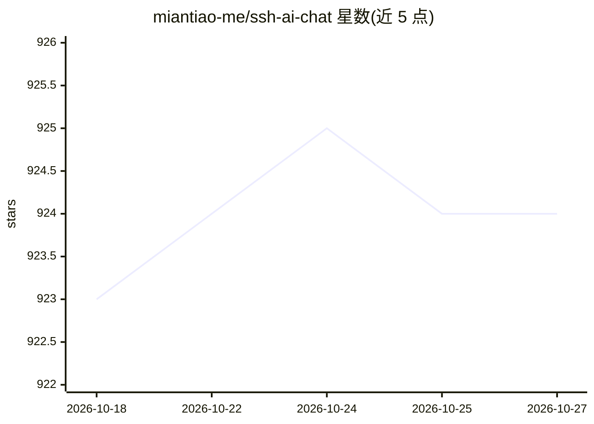

# miantiao-me/ssh-ai-chat

⭐ 924 · TypeScript · AGPL-3.0 · 推送 2025-12-20 · [GitHub](https://github.com/miantiao-me/ssh-ai-chat) · [官网](https://chat.agi.li) · 个人维护 · 中文 README

**通过 SSH 终端与 AI 聊天的自托管 TUI 服务**

自托管服务：用户通过 ssh username@host 直接进入基于 React/Ink 的终端聊天界面与 AI 对话，无需客户端安装。后端为 Node.js + SSH2，数据存 PostgreSQL 与 Redis，官方推荐用 Docker Compose 部署，也可本地开发。支持 macOS 的 iTerm2 与 Ghostty 终端，Linux/Windows 终端兼容性待反馈。由个人开发者维护，提供公开实例 chat.agi.li。

## 筛选速览

| 维度 | 判定 | 备注 |
|---|---|---|
| AI 角色 | `ai-native` | 本体是模型或模型工具 |
| 许可风险 | `viral` | AGPL-3.0 |
| 部署形态 | `self-host` | docker 或自建部署 |
| 模型依赖 | — | README 未给出锁定关系 |
| 硬件要求 | — | 无带数字的原话,不猜 |
| 安装摩擦 | `low` | 无编译、无系统依赖或容器化 |
| 成熟度 | — | 结构信号不足 |

## 能力要点

- SSH 直连即可聊天，终端侧零安装
- React + Ink 终端 UI，Node.js + SSH2 后端
- Docker Compose 一键部署，PostgreSQL + Redis 存储

## 适用场景

- 在服务器上自托管一个 SSH 入口的 AI 聊天服务
- 低配置终端环境下通过 SSH 使用 AI 对话
- 给社区提供一个免安装的终端聊天入口

## 场景标签

`聊天机器人` · 领域:对话与助手

## 证据(README 行号)

> L3: **Chat with AI over SSH.**
> L27: - UI Framework: React and Ink

## 星数曲线

2026-10-18 923 → 2026-10-27 924（+1）

---
*卡片 v1 · prompt 1.4 · 生成 2026-10-21 · 置信度 low · 依据 README sha `51766e115488` · [字段定义](../../DATASET.md)*
