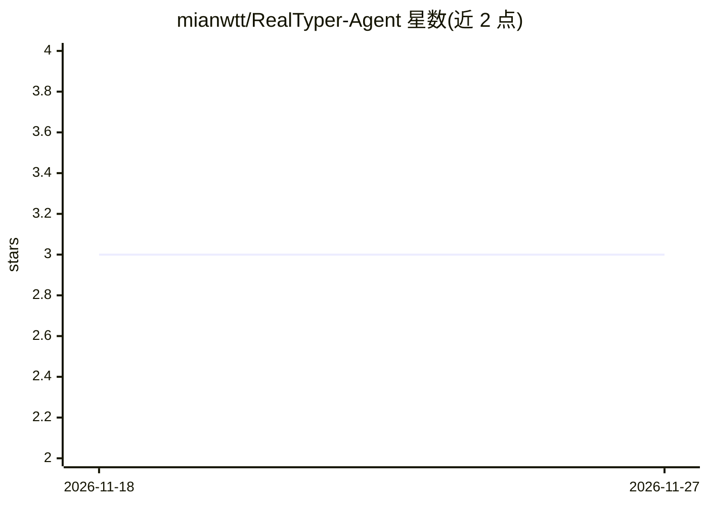

# mianwtt/RealTyper-Agent

⭐ 3 · Python · 推送 2026-11-15 · [GitHub](https://github.com/mianwtt/RealTyper-Agent) · 个人维护 · 中文 README

**Windows 中文录入 agent：规划词组、真实敲拼音并纠错上屏**

读取剪贴板原文，将文字规划为词组，通过微软拼音按键与候选确认完成中文录入，再回读上屏结果，发现差异时局部回删重输。规划可仅靠 jieba 词典离线完成，也可结合本机 Ollama 运行的 Qwen 模型补充分词读音，模型不可用时回退本地计划。提供 Ctrl+Alt+V 快捷模式与带编辑器的验证台，每片段共享 3 次确认额度。兼容范围取决于目标控件，浏览器多行原文暂不支持，密码框拒绝启动。

## 筛选速览

| 维度 | 判定 | 备注 |
|---|---|---|
| AI 角色 | `ai-enhanced` | 去掉 AI 部分产品仍成立 |
| 许可风险 | `none` | — |
| 部署形态 | `library` | 以包/库形式分发 |
| 模型依赖 | local-ok | 支持本地模型 |
| 硬件要求 | — | 无带数字的原话,不猜 |
| 安装摩擦 | `low` | 无编译、无系统依赖或容器化 |
| 成熟度 | — | 结构信号不足 |

## 能力要点

- 通过微软拼音真实按键与候选确认录入，回读比对后局部回删重输
- 词典离线可用；--hybrid 模式结合本机 Ollama 的 qwen3.5:9b，超时或坏计划回退词典
- 验证台窗口展示原文、词组、拼音、录入结果与核验记录
- v1.1.1 附 85 项单元与回归测试，覆盖分词、回退、读音补正与尝试上限

## 适用场景

- 在只允许打字输入的场景把剪贴板文字以真实拼音敲入
- 在原生 Win32 编辑框中从光标处继续插入文字并自动纠错
- 检查多音字与同音词的候选选择策略
- 本地部署 Qwen 模型参与分词与读音规划

## 场景标签

`GUI 自动化` · 领域:效率与自动化

## 证据(README 行号)

> L23: **RealTyper-Agent 是一个 Windows 中文智能录入工具。** 它读取剪贴板里的原文，将文字规划成词组，通过微软拼音按键与候选确认输入，再回读本次新增内容，发现差异时局部回删、重输。
> L81: 默认 `--hybrid` 先生成本地词典计划，再尝试本机 Ollama 的 `qwen3.5:9b`。模型请求最多等待 20 秒；不可用或计划不合格时继续使用本地计划。程序不会自动下载模型。超过 400 字符的原文直接使用本地规

## 星数曲线

2026-11-18 3 → 2026-11-27 3（+0）

---
*卡片 v1 · prompt 1.4 · 生成 2026-11-21 · 置信度 mid · 依据 README sha `cf1d8d24498e` · [字段定义](../../DATASET.md)*
