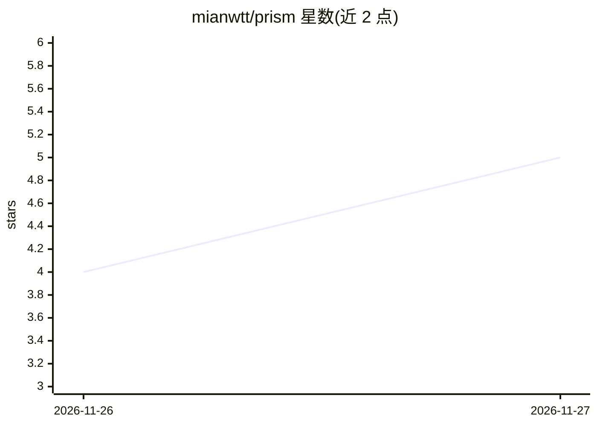

# mianwtt/prism

⭐ 5 · JavaScript · MIT · 推送 2026-11-22 · [GitHub](https://github.com/mianwtt/prism) · 个人维护 · 中文 README

**给决策者一个带依据可推演 What-if 分支的多 Agent 研究工具**

Prism 是一个本地运行的多 Agent 研究与决策工具：协调、研究、审查、分析四个 LangGraph 子图负责搜索、读页与证据核验，最终资格由程序规则判定。研究结果呈现在 What-if 画布上，修改条件时用已收集资料确定性重算，不重新搜索；可保存选择、理由与原始条件，支持 JSON 导入导出。数据存于本机（JSON/SQLite，可选 Redis 缓存）。0.4 为面向本机单用户的开发预览，尚不支持 PDF/Word/Excel/图片导入；演示模式无需模型或搜索 Key。

## 筛选速览

| 维度 | 判定 | 备注 |
|---|---|---|
| AI 角色 | `ai-native` | 本体是模型或模型工具 |
| 许可风险 | `permissive` | MIT |
| 部署形态 | `None` |  |
| 模型依赖 | local-ok | 支持本地模型 |
| 硬件要求 | — | 无带数字的原话,不猜 |
| 安装摩擦 | `low` | 无编译、无系统依赖或容器化 |
| 成熟度 | `idea` | |

## 能力要点

- 四角色 LangGraph 多 Agent 研究与证据审查（反馈补查最多一轮、模型审查两次）
- What-if 画布：改条件即时重算，保留原况并继承子分支
- 方案浮窗展示图片、价格、参数原文与来源链接，可对比分支进出原因
- 决策记忆：保存理由与条件，JSON 导入导出

## 适用场景

- 比较笔记本、手机等商品在不同预算/配置条件下的可选方案
- 按租金与面积条件筛选城市租房房源并保留依据
- 保存一次判断及其原始条件，事后重新核对来源

## 场景标签

`多智能体` · 领域:Agent 开发

## 证据(README 行号)

> L7: **让 Agent 找依据，让你推演每一个「如果」。**
> L85: Prism 由四部分组成：**决策工作区、决策服务、模型与资料、本地数据与缓存**。多 Agent 负责研究资料，确定性内核负责条件推演，两者共同支撑有依据、可回溯的决策。
> L111: Prism 将一次研究拆为 **协调、资料研究、证据审查、决策分析 4 种职责**，分别由独立的 LangGraph 子图承接。各角色只接收本轮所需的上下文和工具权限，通过结构化任务与结果交接。它们共用配置的模型服务、顺序执行；

## 星数曲线

2026-11-26 4 → 2026-11-27 5（+1）

---
*卡片 v1 · prompt 1.4 · 生成 2026-11-26 · 置信度 high · 依据 README sha `75883cbcb969` · [字段定义](../../DATASET.md)*
