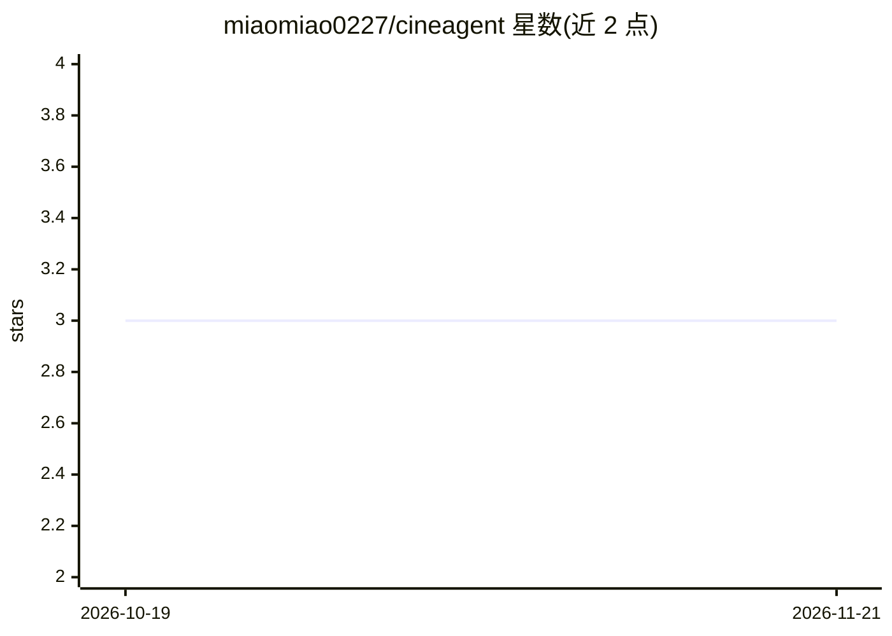

# miaomiao0227/cineagent

⭐ — · [GitHub]() · 个人维护 · 中文 README

**对话式电影推荐系统：偏好记忆+多路线推荐对照评测**

基于 Datawhale FunRec 固定 commit 增量开发的电影推荐项目：FastAPI 后端 + Vue3 前端，推荐链路为多路召回、DeepFM 排序与多样性重排；对话选片支持类型/片长/排除条件、多轮指代、偏好记忆（来源与时间追踪、撤销删除）和有界工具调用。完成 4 条推荐路线评测、40 轮合成对话验收与 9 项模拟故障检查及 Redis 中断恢复验证。数据、模型与密码不随仓库发布，首次需按 REPRODUCE.md 下载预处理并训练。

## 筛选速览

| 维度 | 判定 | 备注 |
|---|---|---|
| AI 角色 | `ai-native` | 本体是模型或模型工具 |
| 许可风险 | `none` | — |
| 部署形态 | `None` |  |
| 模型依赖 | — | README 未给出锁定关系 |
| 硬件要求 | — | 无带数字的原话,不猜 |
| 安装摩擦 | `low` | 无编译、无系统依赖或容器化 |
| 成熟度 | — | 结构信号不足 |

## 能力要点

- 4 条推荐路线评测对照，保留负结果（神经路线未超过 ItemCF）
- 偏好记忆：长期偏好与会话条件分离，含来源/时间追踪与撤销删除
- 工具治理：最多 2 轮模型决策、6 次工具调用，含熔断降级与幂等
- 默认离线规则模式，无须 API key

## 适用场景

- 搭建带偏好记忆的对话式推荐系统并复现评测
- 对比 ItemCF、DeepFM、YouTubeDNN 等推荐路线效果
- 学习推荐系统可靠性设计：超时重试、熔断降级、幂等

## 场景标签

`模型评测` `推荐系统` `教程课程` · 领域:评测与运维

## 证据(README 行号)

> L3: **融合个性化推荐与偏好记忆的对话式电影推荐系统**
> L16: |多路召回 → DeepFM 排序 → 多样性重排|有界工具调用、多轮约束、偏好记忆|超时重试、熔断降级、幂等与可追溯评测|
> L22: - 普通首页：多路召回、DeepFM 排序与多样性重排；首页不依赖 LLM。

## 星数曲线

2026-10-19 3 → 2026-11-21 3（+0）

---
*卡片 v1 · prompt 1.4 · 生成 2026-11-21 · 置信度 high · 依据 README sha `a34a399d4851` · [字段定义](../../DATASET.md)*
