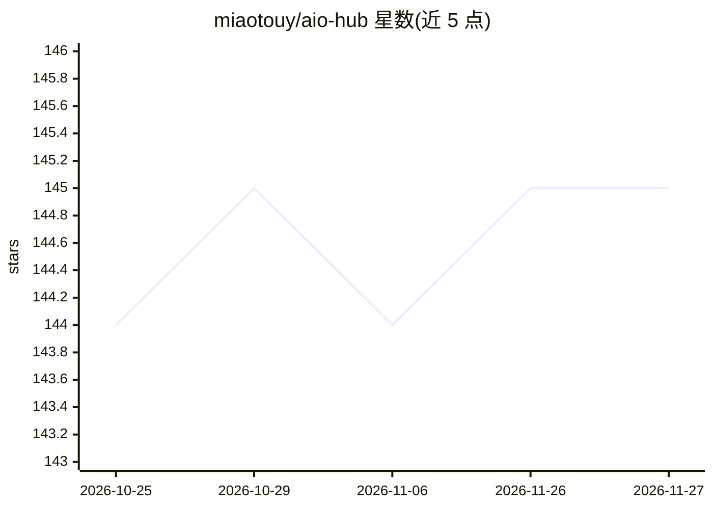

# miaotouy/aio-hub

⭐ 145 · TypeScript · Apache-2.0 · 推送 2026-11-26 · [GitHub](https://github.com/miaotouy/aio-hub) · [官网](http://aiohub-app.com) · 个人维护 · 中文 README

**本地优先的个人 AI 工作站：聊天与工具台二合一**

基于 Tauri + Vue 3 的跨平台桌面应用，定位为本地优先的 AI 能力枢纽。旗舰功能是 LLM 对话工作空间，提供统一上下文管道、上下文压缩、74 个宏、兼容 SillyTavern 的正则与世界书；同时内置网页蒸馏、OCR、窗口自动化、媒体生成、Git 工具等人类工作台。工具通过注册表以 agentCallable 方式受控共享给 Agent，带审批与任务管理；经 VCP 连接器可作分布式节点并桥接远端工具。提供 Windows/macOS/Linux 安装包，源码构建需 Bun、Node.js、Rust 等环境。

## 筛选速览

| 维度 | 判定 | 备注 |
|---|---|---|
| AI 角色 | `ai-native` | 本体是模型或模型工具 |
| 许可风险 | `permissive` | Apache-2.0 |
| 部署形态 | `desktop` | 安装包/桌面程序 |
| 模型依赖 | local-ok | 支持本地模型 |
| 硬件要求 | — | 无带数字的原话,不猜 |
| 安装摩擦 | `medium` | 含编译或系统依赖之一 |
| 成熟度 | — | 结构信号不足 |

## 能力要点

- 统一上下文管道与可视化排序，兼容 SillyTavern 正则/世界书/角色卡
- 工具注册表仅暴露 agentCallable 方法给 Agent，含审批与任务管理
- VCP 双向互操作：本地能力注册到远端，远端插件桥接为本地工具
- 非线性对话图谱、会话级撤销重做与 PNG 角色卡导入导出

## 适用场景

- 在本地桌面管理多厂商 LLM 对话与长会话
- 导入 SillyTavern 角色卡与世界书继续角色扮演
- 让 Agent 在审批边界内调用本机 OCR、网页蒸馏等工具
- 集中处理 OCR、FFmpeg 转码、正则批量替换等日常任务

## 场景标签

`聊天机器人` `AI 助手` `OCR` · 领域:对话与助手

## 证据(README 行号)

> L6:  本地优先的 AI 能力枢纽 | 人类工作台与 Agent 运行时
> L46: AIO Hub 的聊天功能是一个专为复杂任务和深度探索而设计的、高度模块化的**对话式 AI 智能体工作站**。
> L38: - **Agent 运行时**：Agent 可调用已注册并启用的方法。系统负责校验参数、按策略请求审批、管理执行任务，并将结果返回对话。

## 星数曲线

2026-10-25 144 → 2026-11-27 145（+1）

---
*卡片 v1 · prompt 1.4 · 生成 2026-11-27 · 置信度 high · 依据 README sha `ae96db3ebe56` · [字段定义](../../DATASET.md)*
