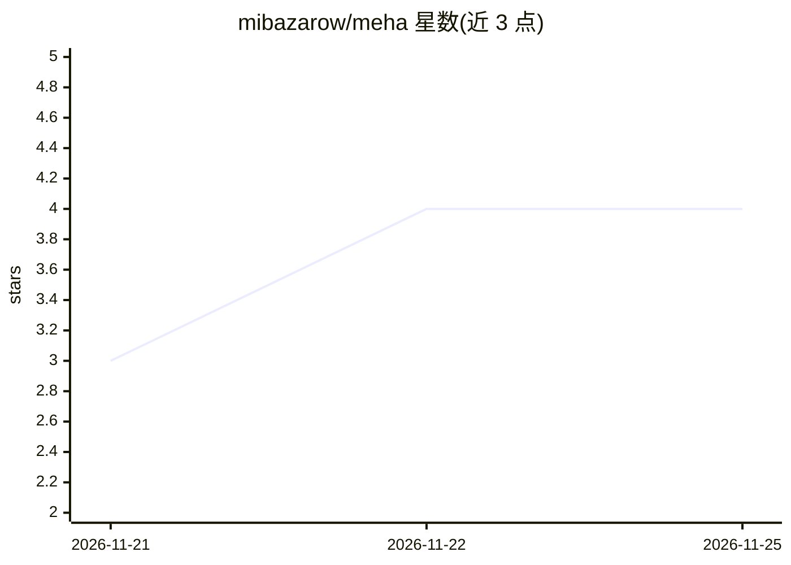

# mibazarow/meha

⭐ 4 · Kotlin · NOASSERTION · 推送 2026-11-20 · [GitHub](https://github.com/mibazarow/meha) · 个人维护

**面向 Android 用户的本地 AI agent 应用，执行设备操作任务**

Меха 是运行在 Android 上的 AI agent 应用，通过官方 Android API 执行任务而非给出建议：管理文件与文档、控制屏幕与第三方应用、收发 SMS、维护长期记忆与离线语义搜索、cron 定时任务和事件驱动自动化规则。共提供 546 个工具。用户自带任意 OpenAI 兼容 LLM 的 API key，密钥加密存于设备；无遥测、无云中转。要求 Android 12+，以 APK 形式分发。README 提明仅在单一设备上测试过，agent 拥有完整权限且无确认对话框。

## 筛选速览

| 维度 | 判定 | 备注 |
|---|---|---|
| AI 角色 | `ai-native` | 本体是模型或模型工具 |
| 许可风险 | `none` | NOASSERTION |
| 部署形态 | `None` |  |
| 模型依赖 | — | README 未给出锁定关系 |
| 硬件要求 | — | 无带数字的原话,不猜 |
| 安装摩擦 | `low` | 无编译、无系统依赖或容器化 |
| 成熟度 | `idea` | |

## 能力要点

- 546 个工具覆盖文件/屏幕/通讯/系统操作，通过官方 Android API 执行
- 设备端离线能力：BM25+语义记忆搜索、OCR（Tesseract）、音频转写（whisper）
- 持久记忆带时间衰减，cron 任务与'事件→动作'自动化规则
- BYOK 模式：任意 OpenAI 兼容 LLM provider，密钥加密存储于设备

## 适用场景

- 用自然语言整理手机文件、发送消息、设置提醒
- 通过屏幕无障碍控制第三方应用，如点击'支付'按钮
- 在设备端转写并搜索录音内容
- 设置定时任务如每日早8点播报课程与天气

## 场景标签

`AI 助手` `Agent 记忆` `语义搜索` `语音识别` · 领域:Agent 开发

## 证据(README 行号)

> L45: **Меха** — не чат-бот и не голосовой ассистент. Это агент, у которого есть руки: он работает
> L46: с телефоном через официальные Android API и выполняет задачу целиком, а не рассказывает, как её
> L158: **Мозг** — языковая модель, **руки** — Android API. Цикл «план → вызов → результат → план».

## 星数曲线

2026-11-21 3 → 2026-11-25 4（+1）

---
*卡片 v1 · prompt 1.4 · 生成 2026-11-21 · 置信度 high · 依据 README sha `57b7e2014a09` · [字段定义](../../DATASET.md)*
