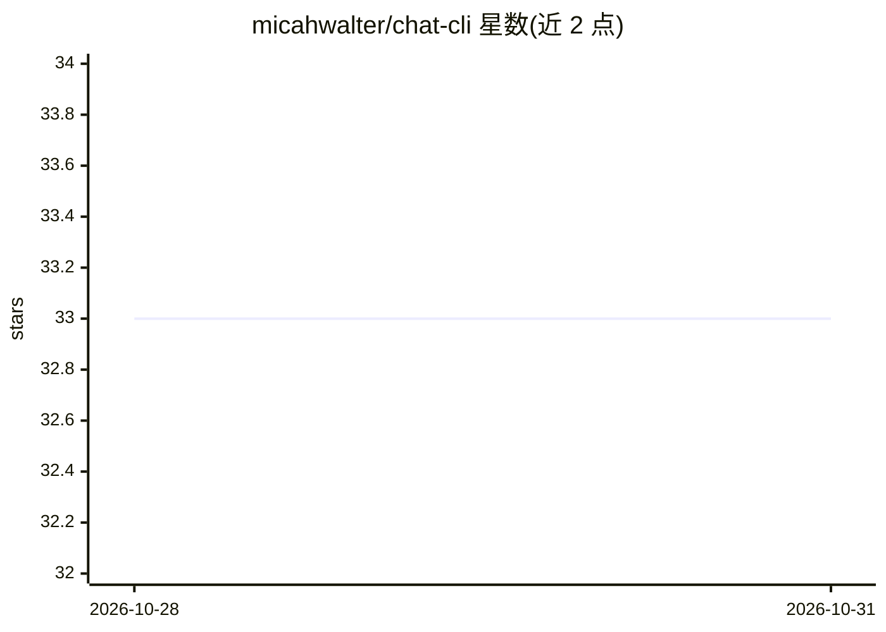

# micahwalter/chat-cli

⭐ 33 · Go · MIT · 推送 2026-10-27 · [GitHub](https://github.com/micahwalter/chat-cli) · [官网](https://chat-cli.chat) · 个人维护

**在终端与 Amazon Bedrock 上的 LLM 对话的 CLI 工具**

Go 编写的终端程序，通过 AWS 凭证访问 Amazon Bedrock 上的基础模型：支持单次 prompt、交互式 chat（会话自动存入本地 sqlite 可恢复）、图像生成三种命令；可附加图片与 PDF/CSV/DOC 等文档、从 stdin 读文件、自动缓存系统提示、支持扩展思考模式与内置 read_file 工具调用（--tools 显式开启）。所有模型需在 Bedrock 控制台自行开通访问，默认模型为 Anthropic 的 claude-sonnet-5。提供预编译二进制与 Homebrew 安装，也可用 Go 1.24+ 从源码构建。

## 筛选速览

| 维度 | 判定 | 备注 |
|---|---|---|
| AI 角色 | `ai-native` | 本体是模型或模型工具 |
| 许可风险 | `permissive` | MIT |
| 部署形态 | `library` | 以包/库形式分发 |
| 模型依赖 | locked-api |  |
| 硬件要求 | — | 无带数字的原话,不猜 |
| 安装摩擦 | `low` | 无编译、无系统依赖或容器化 |
| 成熟度 | — | 结构信号不足 |

## 能力要点

- prompt/chat/image 三种命令覆盖文本对话与图像生成
- chat 会话自动保存到本地 sqlite，可按 chat-id 恢复继续
- 支持图片与 PDF/CSV/DOC 等文档附件、系统提示自动缓存
- 自动发现 AGENTS.md/CLAUDE.md 等项目上下文文件作为系统提示

## 适用场景

- 在终端快速向 Bedrock 模型发送单条提问或管道传入代码文件让其解释
- 进行可保存、可恢复的交互式 LLM 对话
- 用命令行从 Bedrock 基础模型生成图片

## 场景标签

`AI 助手` `图像生成` · 领域:对话与助手

## 证据(README 行号)

> L3: A little terminal based program that lets you interact with LLMs available via Amazon Bedrock.
> L70: 1. Send a single prompt to an LLM from the command line using the `prompt` command
> L71: 2. Start an interactive chat with an LLM using the `chat` command
> L312: With the `image` command you can generate images with any supported Foundation Model. Simply follow the syntax bel

## 星数曲线

2026-10-28 33 → 2026-10-31 33（+0）

---
*卡片 v1 · prompt 1.4 · 生成 2026-10-28 · 置信度 high · 依据 README sha `e8fe6587a66a` · [字段定义](../../DATASET.md)*
