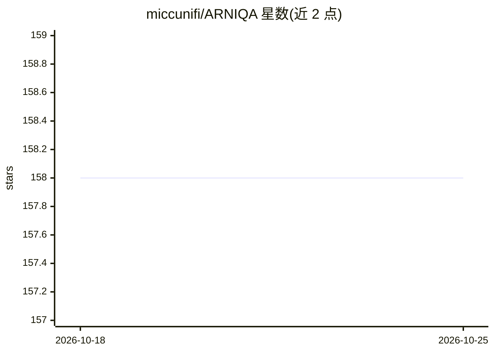

# miccunifi/ARNIQA

⭐ 158 · Python · Apache-2.0 · 推送 2026-06-18 · [GitHub](https://github.com/miccunifi/ARNIQA) · 组织维护

**自监督无参考图像质量评估模型（WACV 2024 论文官方实现）**

佛罗伦萨大学团队发表的 ARNIQA 论文（WACV 2024 Oral）官方代码库。方法为自监督学习图像失真流形：通过随机组合有序失真序列的退化模型合成训练数据，最大化同等退化、不同内容图像块的表示相似度，再用线性回归器将表示映射为 [0,1] 质量分数，无需微调编码器。支持单图推理（torch.hub 免克隆）、基于 conda 环境的源码安装、在 LIVE/CSIQ/TID2013/KADID10K 等数据集上训练与测试，训练需 W&B 账号。亦可通过 IQA-PyTorch 工具箱调用。

## 筛选速览

| 维度 | 判定 | 备注 |
|---|---|---|
| AI 角色 | `ai-native` | 本体是模型或模型工具 |
| 许可风险 | `permissive` | Apache-2.0 |
| 部署形态 | `desktop` | 安装包/桌面程序 |
| 模型依赖 | — | README 未给出锁定关系 |
| 硬件要求 | — | 无带数字的原话,不猜 |
| 安装摩擦 | `low` | 无编译、无系统依赖或容器化 |
| 成熟度 | — | 结构信号不足 |

## 能力要点

- 自监督对比学习建模图像失真流形
- 线性回归器映射质量分数，不微调编码器
- torch.hub 免克隆单图推理，输出 [0,1] 分数
- 提供 8 个 IQA 数据集上的训练/测试流程

## 适用场景

- 给单张图像打质量分数（无参考）
- 复现论文训练与测试
- 在自有 IQA 数据集上训练质量评估模型

## 场景标签

`图像视频处理` · 领域:感知与多模态

## 证据(README 行号)

> L14: This is the **official repository** of the **paper** "*ARNIQA: Learning Distortion Manifold for Image Quality Asses
> L23: No-Reference Image Quality Assessment (NR-IQA) aims to develop methods to measure image quality in alignment with h

## 星数曲线

2026-10-18 158 → 2026-10-25 158（+0）

---
*卡片 v1 · prompt 1.4 · 生成 2026-10-22 · 置信度 high · 依据 README sha `c537ae29401b` · [字段定义](../../DATASET.md)*
